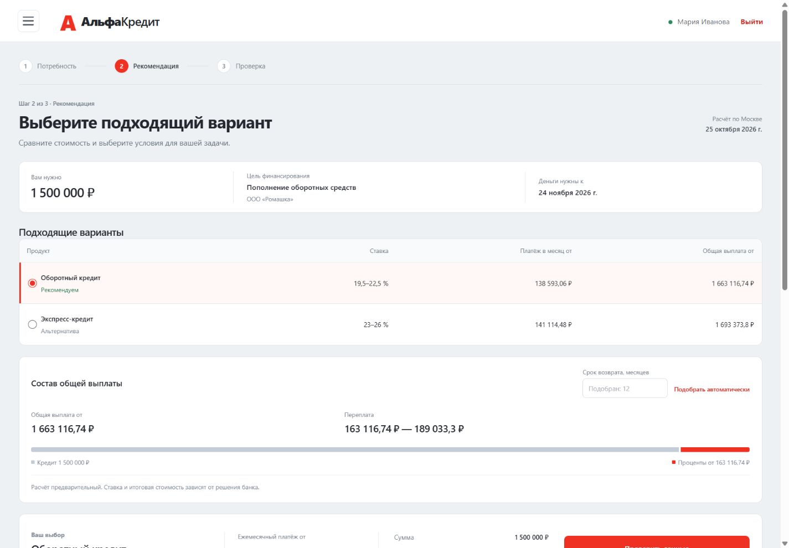
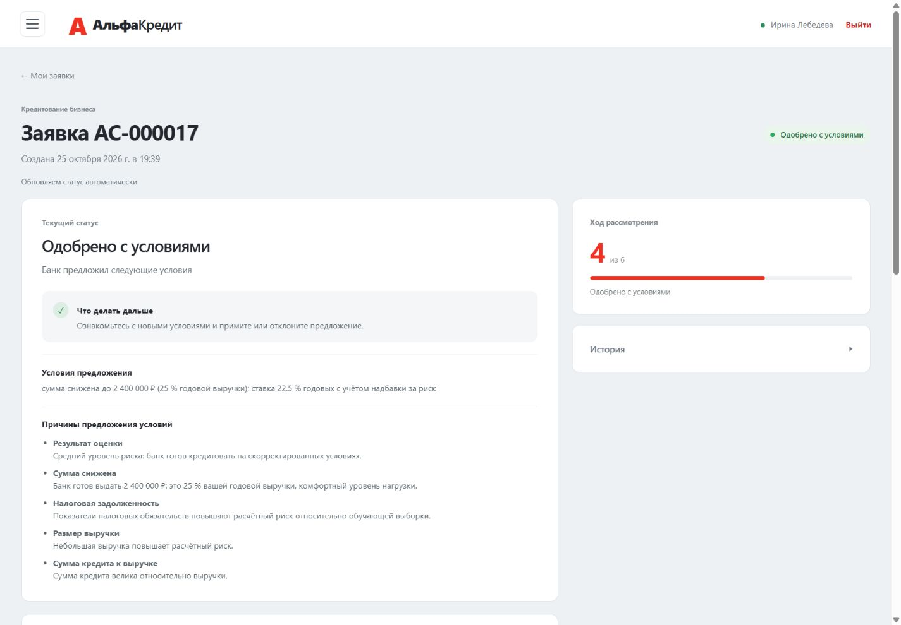
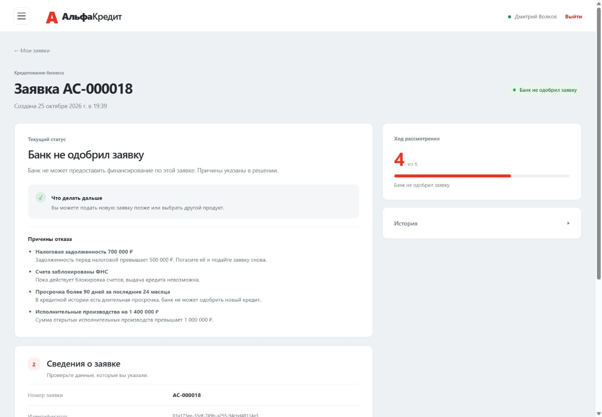
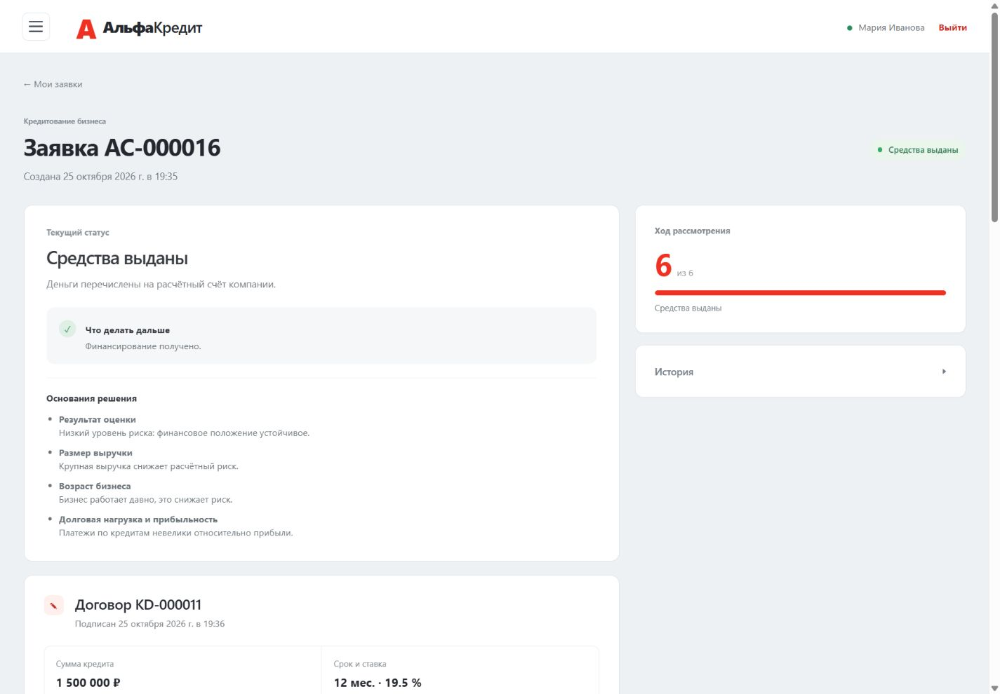

# АльфаКредит: умный кредитный кабинет предпринимателя

Продуктовый обзор для заочной проверки хакатона. Подготовлен 26 октября 2026 года по рабочей сборке, проверенной 25 октября. Технический запуск описан в [README](README.md) и [пошаговой инструкции](docs/quickstart.md).

## Для кого и какую задачу решаем

Представителю малого или микробизнеса нужны деньги на конкретную задачу. Ему важно выбрать условия, оценить платёж и общую стоимость, передать сведения о компании и понимать результат рассмотрения. Банку нужен связанный процесс с проверками, оценкой риска, правилами решения и сохранением истории.

АльфаКредит объединяет эти действия в веб-кабинете: потребность, предварительный подбор, заявка, банковская обработка, предложение, договор и демонстрационная выдача.

## Исследование и влияние на продукт

Команда опросила **10 предпринимателей**. В исходных материалах респонденты Р1 и Р7 иллюстрируют выводы исследования. Это качественные наблюдения: мы не заявляем доли ответов, статистическую репрезентативность или измеренный эффект для всего рынка.

| Наблюдение | Принятое решение | Как проверить |
|---|---|---|
| Полную стоимость сложнее оценить, чем ставку и платёж | Показать общую выплату и переплату в рублях вместе с платежом | Мастер подбора и предложение банка |
| Статус заявки выясняют через менеджера | Показать этапы рассмотрения и следующий шаг в кабинете | Карточка заявки и история |
| После отказа не хватает понятного объяснения | Показывать причины отказа и изменения условий | Профили client_bad и client_reduced |

Перечень всех участников и полный исследовательский архив в этот комплект не входят. Источник качественных выводов — исследовательская часть исходной презентации команды; размер выборки уточнён командой при подготовке этого обзора.

## Основные возможности

### Предварительный подбор под потребность

Пользователь указывает цель, сумму и дату потребности. Кабинет предлагает подходящие продукты, показывает ориентир получения денег при одобрении, платёж, общую выплату и переплату. Можно изменить срок.

Preview не создаёт заявку и не оценивает вероятность одобрения. Стоимость предварительная, по базовым ставкам; точные условия появляются после проверки заявки. Овердрафт и кредитная линия не сравниваются с обычным кредитом по аннуитетной общей стоимости.

### Понятный результат рассмотрения

В клиентском кабинете четыре основных результата: одобрено, одобрено с условиями, рассмотрение менеджером и отказ. Пользователь видит фактические условия, причины и доступные действия. Внутренние грейды A–E, баллы и PD остаются в банковском представлении.

Пример: компания запрашивает 3 млн ₽ на 24 месяца. Банк предлагает 2,4 млн ₽ под 22,5 % и объясняет, что сумма ограничена 25 % годовой выручки. Платёж составляет 125 100,96 ₽. Пользователь может принять или отклонить предложение.

Если срабатывают стоп-факторы, кабинет показывает причины отказа. Для отклонённой заявки договор и выдача недоступны.

### Сохранение контекста до результата

После подачи backend проверяет данные, запрашивает симуляторы внешних источников, рассчитывает риск и применяет кредитную политику. Крупные суммы и нестандартные случаи переходят на рассмотрение менеджера. В демо-режиме ответ менеджера моделируется и явно помечается в интерфейсе.

Клиент принимает предложение, открывает договор и график, подтверждает подписание кодом внутри кабинета и получает результат демонстрационной выдачи. Код не требует настоящего SMS. Предложение действует 7 дней, а не 30 дней.

## Устройство решения

- React отвечает за клиентский веб-интерфейс.
- ASP.NET Core ведёт заявку, внешние проверки, правила решения, договор и выдачу.
- PostgreSQL сохраняет заявки, результаты, историю, договоры и записи выдачи.
- Python-сервис рассчитывает риск с помощью логистической регрессии на синтетических данных.

Скоринг даёт оценку риска. Итоговое решение учитывает также стоп-факторы, ограничения продукта, сумму, срок и наличие обязательных данных. Поэтому хороший грейд сам по себе не гарантирует автоматического одобрения.

При недоступном Python backend рассчитывает ту же модель локально по общему артефакту. Проверены совпадение версии/хеша артефакта и согласованность результатов External и RulesFallback. Подробности устройства и API находятся в закреплённом backend-репозитории.

## Что проверено

Для сборки от 25 октября:

- 110 тестов фронтенда и production-сборка прошли.
- Для того же backend-коммита ранее пройдены 310 unit- и 55 integration-тестов.
- На рабочем API прошли 77 проверок пяти сквозных сценариев External.
- На отдельном экземпляре того же собранного образа API с недоступным ML прошла 81 проверка RulesFallback. Это не 158 различных пользовательских сценариев.
- Одобрение и уменьшенная сумма дошли до демонстрационной выдачи. Отказ не создал договор и выдачу.
- После перезапуска четырёх сервисов сохранились все 19 заявок, существовавших в этот момент, и их финансовые данные. Исходные 11 заявок также остались доступны после обновления.
- В браузере пройдены мастер подбора, четыре результата, договор, неверный и верный коды и печатная форма.

После длительной паузы одна открытая вкладка показала ошибку автообновления и сохранила прежнюю карточку. Повторный вход загрузил актуальное решение; постоянный сбой не воспроизведён.

## Границы демонстрации

Данные компаний и финансовые показатели синтетические. ЕГРЮЛ/ЕГРИП, ФНС, БКИ, ФССП, код подтверждения и выдача воспроизводятся симуляторами. Реальных банковских проверок, SMS и денежных переводов нет. Метрики ML на синтетике не доказывают качество на реальных заёмщиках.

В текущей версии нет живого чата, открытия банковского счёта, оценки шансов до подачи, распознавания загруженных выписок, переключения «владелец/бухгалтер», автоматических будущих напоминаний и сравнения с личной кредитной картой. Отдельный интерфейс сотрудника банка не заявляется; банковские данные доступны через авторизованный API.

## Что проверять дальше

В пилоте можно измерять завершение заявки, отказы на шагах, понимание причин решения и потребность в обращении к менеджеру. Рост конверсии и снижение нагрузки на сотрудников пока остаются гипотезами.

Возможное развитие: работа с выписками, настройка дополнительных запросов к клиенту и более подробная помощь после отказа. Эти возможности не входят в описанный готовый прототип.
