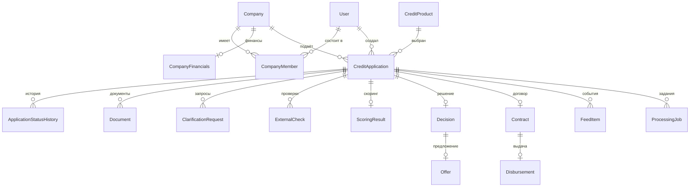
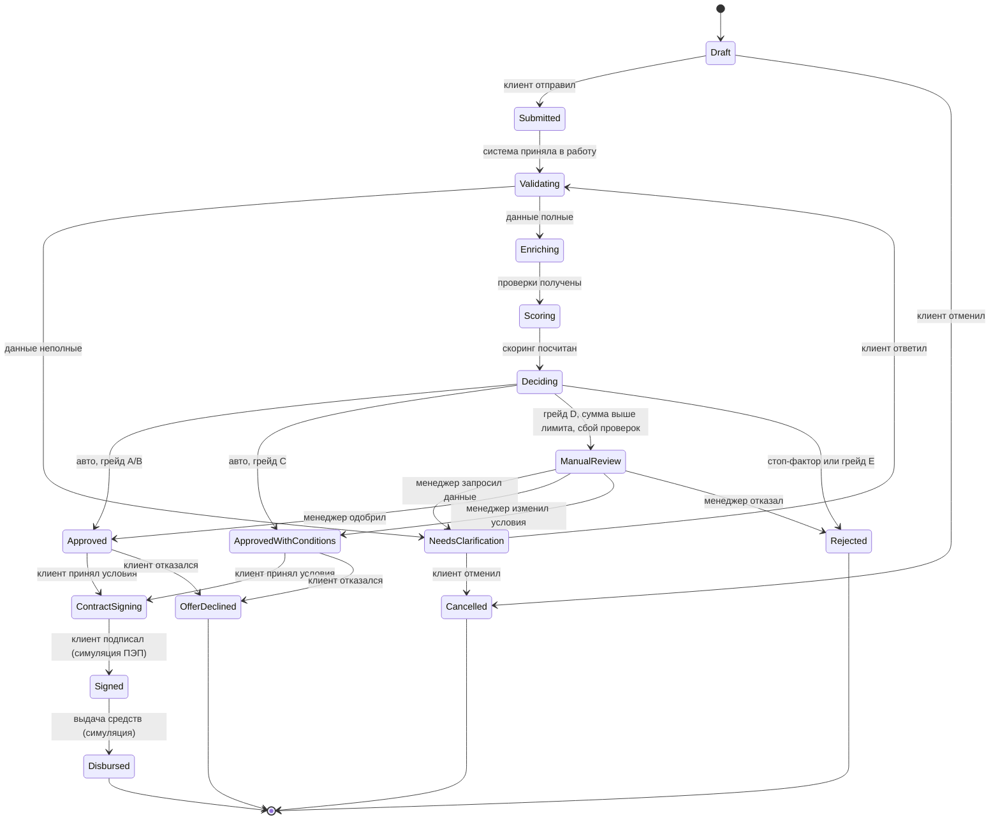

# План backend: «Умный кредитный кабинет предпринимателя»

Кейс: цифровой кредитный конвейер для малого и микробизнеса (хакатон Альфа-Банка).
Стек backend: ASP.NET Core MVC (Web API на контроллерах) + PostgreSQL + EF Core + Docker Compose.

---

## 0. Допущения

1. **Backend = REST API** на контроллерах ASP.NET Core MVC (`[ApiController]`), JSON, JWT.
   Веб-интерфейс делает отдельный фронтенд (SPA). Если фронтендера в команде нет, те же
   контроллеры отдают Razor-views: домен, сервисы и конвейер не меняются, добавляются Views
   и cookie-auth вместо JWT.
2. **Все внешние системы** (ЕГРЮЛ/ЕГРИП, ФНС «Прозрачный бизнес», БКИ, ФССП) заменены
   локальными симуляторами с синтетическими данными (ограничение «Автономность»).
3. **Подписание договора и выдача денег** симулируются внутри продукта. SMS и email
   в сценарии запрещены, поэтому код подтверждения подписи показывается прямо в кабинете.
4. **Логика кредитного решения** явная и табличная: балльная модель + правила политики,
   без ML. Она описана в `docs/decision-logic.md` и отображается клиенту «человеческим языком».
5. LLM не входит в обязательный сценарий. Если добавлять, то только open-weights модель
   через Ollama, выключенную по умолчанию, с rule-based fallback.

---

## 1. Требования кейса → задачи backend

| Требование кейса | Что делаем в backend |
|---|---|
| Личный кабинет: выбор продукта, путь от подачи заявки до результата | Каталог и подбор продуктов, мастер заявки, статусы с подсказкой «что дальше», документы, ответы на запросы банка, принятие оффера, подписание, выдача |
| Этапы обработки на стороне банка и модель принятия решения | Конвейер: валидация → обогащение → скоринг → решение; очередь андеррайтера с ручным решением |
| Данные сохраняются, система реагирует на действия, состояние меняется динамически | PostgreSQL, явная state machine, фоновый обработчик с задержками этапов, SignalR + polling |
| Лента новостей клиента (упомянута в требованиях к демо) | Персональная лента событий и рекомендаций (`FeedItem`) в кабинете |
| Docker и единый воспроизводимый запуск | `docker compose up --build`: db + api (+ frontend) |
| Фиксация версий | `global.json`, Central Package Management, `packages.lock.json`, теги docker-образов |
| README, THIRD_PARTY_NOTICES, схема архитектуры, OpenAPI, коллекция запросов, диаграмма состояний, модель данных, тестовые сценарии | Папка `docs/` с Mermaid-диаграммами, экспорт `openapi.json`, `requests.http` + Postman-коллекция |
| Синтетические данные и тестовые учётки | Seed при старте: продукты, компании с профилями «хороший/средний/плохой/новый», пользователи всех ролей, заявки в разных статусах |
| Enterprise-ориентированность | Слои, валидация, авторизация по ролям и ресурсам, ретраи и таймауты, health checks, структурные логи, аудит, тесты, CI |
| Независимость от платных ресурсов | Только OSS с permissive-лицензиями, см. раздел 2 |

---

## 2. Архитектура

### 2.1. Структура решения

```
alpha-hahaton/
├─ src/
│  ├─ AlfaCredit.Api/              # ASP.NET Core MVC: контроллеры, DTO, auth, Swagger, SignalR, Program.cs
│  ├─ AlfaCredit.Core/             # домен + сценарии: сущности, enum'ы, state machine, скоринг,
│  │                               # кредитная политика, интерфейсы (порты), валидаторы, доменные события
│  └─ AlfaCredit.Infrastructure/   # EF Core (DbContext, миграции, репозитории), симуляторы внешних
│                                  # сервисов, файловое хранилище, фоновый worker, seed-данные
├─ tests/
│  ├─ AlfaCredit.UnitTests/        # скоринг, политика решений, переходы состояний, валидаторы
│  └─ AlfaCredit.IntegrationTests/ # API end-to-end: WebApplicationFactory + Testcontainers (Postgres)
├─ docs/
│  ├─ architecture.md              # C4-схема (Mermaid), компоненты, потоки
│  ├─ state-machine.md             # диаграмма состояний заявки + таблица переходов
│  ├─ data-model.md                # ER-диаграмма и описание сущностей
│  ├─ decision-logic.md            # скоринг, стоп-факторы, политика решений
│  ├─ api.md + openapi.json        # описание API и экспорт Swagger
│  ├─ requests.http                # коллекция запросов (VS Code REST Client / Rider), + postman_collection.json
│  └─ test-scenarios.md            # пошаговые сценарии проверки
├─ deploy/
│  ├─ docker-compose.yml, Dockerfile, .env.example, nginx.conf (если фронт в том же compose)
├─ .github/workflows/ci.yml        # build + test + docker build
├─ global.json, Directory.Build.props, Directory.Packages.props, .editorconfig
├─ README.md, THIRD_PARTY_NOTICES.md
```

Правило зависимостей: `Api → Core ← Infrastructure`. Core не знает про EF Core и HTTP.
Контроллеры тонкие: валидация входа → вызов сервиса сценария → маппинг в DTO.
Любое изменение статуса заявки проходит через один класс `ApplicationWorkflow`.

### 2.2. Стек и версии

| Компонент | Выбор | Комментарий |
|---|---|---|
| Runtime | .NET 10 LTS | Fallback .NET 8, но его поддержка заканчивается в ноябре 2026. Фиксируем в `global.json` |
| Web | ASP.NET Core MVC, `[ApiController]`, маршруты `/api/v1/...` | Выбор команды |
| БД | PostgreSQL 16 + EF Core + Npgsql, миграции в репозитории | `xmin` как concurrency token на заявке |
| Auth | JWT Bearer; своя таблица `User` + `PasswordHasher<User>`; роли Client / Manager / Admin | Проще полного ASP.NET Identity, достаточно для прототипа |
| Валидация | FluentValidation | Явные правила, понятные ошибки |
| OpenAPI | Swashbuckle.AspNetCore (или встроенный `Microsoft.AspNetCore.OpenApi` + Scalar UI) | Обязательный артефакт сдачи |
| Логи | Serilog, JSON в stdout, correlation-id в каждом запросе | Cloud-native |
| Устойчивость | `Microsoft.Extensions.Http.Resilience` (Polly v8): retry, timeout, circuit breaker к симуляторам | Enterprise-критерий |
| Health | `AspNetCore.HealthChecks.NpgSql`: `/health/live`, `/health/ready` | Для docker healthcheck |
| Realtime | SignalR hub `/hubs/applications` + fallback polling | «Динамичное отображение состояния» |
| Синтетика | Bogus (MIT) с фиксированным seed | Детерминированные данные |
| Тесты | xUnit, Shouldly, Testcontainers.PostgreSql | |
| Маппинг | Руками или Mapperly (MIT, source generator) | |

**Лицензии.** Не берём библиотеки, которые перешли на коммерческие лицензии:
MediatR 13+, AutoMapper 15+, FluentAssertions 8+. Генерацию PDF договора не делаем
(QuestPDF имеет условия по выручке), договор отдаём как HTML.

**Фиксация версий.** `global.json` (SDK), `Directory.Packages.props` (единые версии пакетов),
`RestorePackagesWithLockFile=true` → `packages.lock.json` в каждом проекте, точные теги образов
в compose (`postgres:16-alpine`, `mcr.microsoft.com/dotnet/aspnet:10.0`).

### 2.3. Docker

- `Dockerfile` multi-stage: `sdk` → `dotnet publish` → `aspnet` runtime, non-root пользователь.
- `docker-compose.yml`: `db` (volume, healthcheck), `api` (depends_on db healthy, переменные из `.env`),
  `frontend` (nginx со сборкой SPA и прокси `/api` → api), если фронт кладём в тот же compose.
- Миграции и seed применяются на старте api по флагам `Database__MigrateOnStartup=true`,
  `Seed__Enabled=true` (в README честно пишем, что в проде это отдельный migration job).
- Один запуск: `docker compose up --build` → Swagger на `http://localhost:8080/swagger`.
- Переменные окружения: `ConnectionStrings__Default`, `Jwt__Key`, `Jwt__Issuer`,
  `Processing__StageDelaySeconds`, `Simulators__FailureRate`, `Storage__Root`, `Cors__Origins`.

---

## 3. Модель данных

| Сущность | Ключевые поля |
|---|---|
| `User` | логин, hash пароля, ФИО, роль (Client, Manager, Admin), активен |
| `Company` | ИНН, ОГРН/ОГРНИП, форма (ООО/ИП), наименование, ОКВЭД, дата регистрации, адрес, руководитель, налоговый режим, расчётный счёт |
| `CompanyFinancials` | выручка за 12 мес, расходы, чистая прибыль, текущие ежемесячные платежи по кредитам, число сотрудников, период |
| `CompanyMember` | пользователь ↔ компания, роль в компании (Owner, Director, Accountant, Employee) |
| `CreditProduct` | код, название, описание «для человека», тип (оборотный, инвестиционный, овердрафт, кредитная линия, экспресс), min/max сумма и срок, базовая ставка, допустимые цели, требования (мин. возраст бизнеса, нужен ли залог, обязательные документы), лимит автоодобрения |
| `CreditApplication` | номер, компания, автор, продукт, сумма, срок, цель, комментарий, статус, назначенный менеджер, флаг «был в ручном рассмотрении», created/updated, `xmin` |
| `ApplicationStatusHistory` | заявка, из → в, актор (пользователь или система), комментарий, время |
| `Document` | заявка, тип (устав, паспорт, бух. отчётность, выписка по счёту, иное), имя файла, размер, путь, статус (Uploaded, Verified, Rejected), комментарий проверяющего |
| `ClarificationRequest` | заявка, текст запроса, список нужных документов, кто запросил, статус (Open, Answered), ответ клиента, время |
| `ExternalCheck` | заявка, источник (Egrul, FnsTransparentBusiness, CreditBureau, Fssp), статус, результат (JSON), краткий вывод, флаги риска, попытки, время |
| `ScoringResult` | заявка, балл, грейд (A–E), разбивка по факторам (JSON), версия модели, время |
| `Decision` | заявка, тип (Approved, ApprovedWithConditions, Rejected, NeedMoreInfo), сумма/срок/ставка, условия, коды причин + текст, кто принял (Auto или Manager), авто-рекомендация, время |
| `Offer` | решение, условия, срок действия, ответ клиента (Pending, Accepted, Declined), время ответа |
| `Contract` | заявка, номер, HTML-текст, статус (Draft, Signed), кто и когда подписал, код подтверждения |
| `Disbursement` | договор, сумма, счёт, статус (Pending, Executed), время |
| `FeedItem` | пользователь/компания, заявка, тип (StatusChanged, ClarificationRequested, OfferReady, ContractReady, Disbursed, Recommendation, News), заголовок, текст, ссылка, прочитано |
| `ProcessingJob` | заявка, этап (Validate, Enrich, Score, Decide, Disburse), статус (Pending, Running, Done, Failed), попытки, nextRunAt, ошибка |
| `AuditEntry` | актор, действие, тип и id сущности, payload, время, correlation-id |



---

## 4. Жизненный цикл заявки



Правила:

- Переходы описаны одной таблицей `(from, to, allowedActors)` в `ApplicationWorkflow`.
  Метод `Transition()` проверяет допустимость, пишет `ApplicationStatusHistory`, `FeedItem`,
  `AuditEntry` и публикует событие в SignalR. Других способов сменить статус нет.
- Если заявка вернулась из `NeedsClarification`, конвейер запускается заново
  (данные могли измениться). Флаг «был в ручном рассмотрении» возвращает её менеджеру,
  а не в автоодобрение.
- Оффер имеет срок действия (например, 7 дней); истечение переводит в `OfferDeclined`
  с причиной `Expired` (фоновая проверка раз в минуту).
- Оптимистическая блокировка через `xmin`: два менеджера не примут два решения по одной заявке.

Для каждого статуса API отдаёт фронту справочник:
`code`, `title`, `clientDescription`, `clientNextAction`, `bankNextAction`, `isTerminal`,
`progressStep` (1..7 для прогресс-бара). Это закрывает критерий «помогает понимать действия
на каждом этапе» без банковской экспертизы у пользователя.

---

## 5. Конвейер обработки (банковская сторона, автомат)

1. `POST /applications/{id}/submit` переводит заявку в `Submitted`, создаёт
   `ProcessingJob(Validate)` и возвращает `202 Accepted`.
2. `ProcessingWorker : BackgroundService` раз в 500 мс забирает Pending-задания
   (`SELECT ... FOR UPDATE SKIP LOCKED`, чтобы можно было запустить несколько инстансов),
   выполняет этап, сохраняет результат и ставит следующее задание.
3. Этапы:
   - **Validate**: полнота обязательных полей и документов по продукту, сумма/срок в границах
     продукта, возраст бизнеса ≥ требования. Неполно → `NeedsClarification` с автоматически
     сформированным списком недостающего.
   - **Enrich**: параллельные вызовы симуляторов ЕГРЮЛ/ЕГРИП, ФНС «Прозрачный бизнес»,
     БКИ, ФССП. Результаты в `ExternalCheck`.
   - **Score**: балльная модель (раздел 6), `ScoringResult` с разбивкой по факторам.
   - **Decide**: политика решений (раздел 6) → `Decision` + `Offer` либо маршрут в `ManualReview`.
   - **Disburse**: после подписания договора, симуляция выдачи с задержкой.
4. Задержка этапа настраивается `Processing__StageDelaySeconds` (по умолчанию 2–3 с),
   чтобы на демо было видно, как заявка движется по этапам.
5. Сбой этапа: retry с экспоненциальным backoff до 3 попыток. Если проверки так и не получены,
   заявка уходит в `ManualReview` с пометкой «проверка недоступна», а не теряется.

### Симуляторы внешних сервисов

| Сервис | Что возвращает | Как влияет |
|---|---|---|
| ЕГРЮЛ/ЕГРИП | существование, статус (действует / ликвидация / прекращена), дата регистрации, ОКВЭД, руководитель, адрес | предзаполнение карточки компании по ИНН, стоп-фактор, возраст бизнеса |
| ФНС «Прозрачный бизнес» | налоговая задолженность, массовый адрес, дисквалифицированный руководитель, среднесписочная численность, выручка по отчётности | стоп-факторы, сверка выручки с анкетой |
| БКИ | активные кредиты, общая задолженность, макс. просрочка за 24 мес, платёжная дисциплина | долговая нагрузка, кредитная история |
| ФССП | сумма открытых исполнительных производств | штраф к баллу, стоп-фактор |

- Реализация: интерфейсы `IEgrulClient`, `IFnsClient`, `ICreditBureauClient`, `IFsspClient` в Core,
  реализации в Infrastructure. Детерминированы по ИНН: `seed = hash(ИНН)`, поэтому любой введённый
  ИНН даёт правдоподобную и воспроизводимую карточку. Для 6–8 «именных» ИНН из seed заданы явные
  профили (хороший, средний, плохой, новый бизнес, ликвидируемый).
- `Simulators__FailureRate` задаёт вероятность таймаута/ошибки, чтобы показать ретраи и
  маршрут «проверка недоступна → ManualReview».
- Вариант A (сначала): in-process классы. Вариант B (если останется время): отдельный проект
  `AlfaCredit.Simulators` как контейнер в compose, вызовы по HTTP с resilience-пайплайном.
  Интерфейсы при этом не меняются.

---

## 6. Скоринг и кредитная политика

Балл стартует с 50. Грейды: **A ≥ 80, B 65–79, C 50–64, D 35–49, E < 35**.

| Фактор | Источник | Правило |
|---|---|---|
| Возраст бизнеса | ЕГРЮЛ | < 6 мес: −20; 6–12 мес: −10; 1–3 года: 0; > 3 лет: +10 |
| Годовая выручка / запрошенная сумма | анкета, ФНС | ≥ 4: +15; 2–4: +5; 1–2: −5; < 1: −20 |
| Долговая нагрузка: (текущие платежи + новый платёж) / месячная прибыль | анкета, БКИ | < 0.3: +10; 0.3–0.5: 0; 0.5–0.7: −10; > 0.7: −25 |
| Кредитная история | БКИ | без просрочек: +15; просрочки ≤ 30 дн: −5; 31–90 дн: −15 |
| Налоговая задолженность | ФНС | 0: +5; < 50 тыс: −5; ≥ 50 тыс: −15 |
| Исполнительные производства | ФССП | нет: 0; есть: −10 |
| Залог (если продукт допускает) | анкета | +10 |

**Стоп-факторы** (отказ без скоринга): компания не действует или в стадии ликвидации;
дисквалифицированный руководитель; просрочка > 90 дней за последние 24 мес;
налоговая задолженность ≥ 500 тыс ₽; исполнительные производства > 1 млн ₽.

**Политика решения:**

| Условие | Результат |
|---|---|
| Стоп-фактор или грейд E | `Rejected` с кодами и текстом причин |
| Грейд A/B и сумма ≤ лимит автоодобрения продукта | `Approved` на запрошенных условиях, ставка = базовая + премия грейда |
| Грейд C | `ApprovedWithConditions`: сумма = min(запрошенная, 25 % годовой выручки), срок ≤ лимит продукта, ставка + 3 п.п. |
| Грейд D, или сумма выше лимита автоодобрения, или не все проверки получены | `ManualReview` с авто-рекомендацией для менеджера |

Премия к ставке по грейду: A 0, B +1.5, C +3, D +5 п.п.
Менеджер в `ManualReview` может одобрить, изменить условия или отказать, обязательно с комментарием.
Система хранит и авто-рекомендацию, и решение менеджера (аудит расхождений).

**Объяснимость.** У каждого фактора есть текст «для клиента» («Долговая нагрузка выше комфортной,
поэтому сумма снижена»). Клиент видит объяснение, менеджер видит баллы и сырые данные проверок.

---

## 7. API (REST, `/api/v1`)

**Auth**
- `POST /auth/register`, `POST /auth/login` → JWT, `GET /auth/me`

**Companies**
- `GET /companies/lookup?inn=` предзаполнение из симулятора ЕГРЮЛ
- `POST /companies`, `GET /companies/{id}`, `PUT /companies/{id}/financials`

**Products**
- `GET /products`, `GET /products/{code}`
- `POST /products/recommend` (цель, сумма, срок → ранжированный список с объяснением, почему подходит / не подходит)
- `POST /products/{code}/calculate` (предварительный платёж и диапазон ставки)

**Applications (клиент)**
- `POST /applications` черновик; `GET /applications`; `GET /applications/{id}` (статус, этап, «что дальше», таймлайн, решение, оффер)
- `PUT /applications/{id}` правка черновика
- `POST /applications/{id}/documents` (multipart), `DELETE /applications/{id}/documents/{docId}`
- `POST /applications/{id}/submit`, `POST /applications/{id}/cancel`
- `GET /applications/{id}/clarifications`, `POST /applications/{id}/clarifications/{reqId}/answer`
- `POST /applications/{id}/offer/accept`, `POST /applications/{id}/offer/decline`
- `GET /applications/{id}/contract`, `POST /applications/{id}/contract/sign` (код показывается в UI)
- `GET /applications/{id}/history`

**Feed (лента новостей и событий)**
- `GET /feed`, `GET /feed/unread-count`, `POST /feed/{id}/read`

**Bank (роль Manager)**
- `GET /bank/applications?status=&assignedToMe=&page=` очередь
- `GET /bank/applications/{id}` полная карточка: анкета, документы, проверки, скоринг, авто-рекомендация
- `POST /bank/applications/{id}/assign`
- `POST /bank/applications/{id}/clarification` запрос данных
- `POST /bank/applications/{id}/decision` (approve / approve-with-conditions / reject + комментарий)
- `POST /bank/applications/{id}/documents/{docId}/verify`
- `POST /bank/applications/{id}/comments` внутренние заметки
- `GET /bank/dashboard` счётчики по статусам

**Admin**
- CRUD `/admin/products`, `GET /admin/audit`, `GET|PUT /admin/decision-policy` (пороги автоодобрения)

**System**
- `GET /health/live`, `GET /health/ready`, `/swagger`, SignalR hub `/hubs/applications`

**Соглашения контракта:** JSON camelCase, enum как строки, даты ISO 8601 UTC,
ошибки в формате ProblemDetails (RFC 7807) с кодами, пагинация `?page=&pageSize=`,
JWT в `Authorization: Bearer`, файлы до 10 МБ (pdf, png, jpg, xlsx).
Swagger со stub-ответами публикуем в первый день, чтобы фронт не ждал.

---

## 8. Enterprise-требования

- **Безопасность:** JWT с коротким TTL, хеширование паролей, политики `ClientOnly` / `BankOnly` / `AdminOnly`,
  resource-based проверка «клиент видит только заявки своей компании» в сервисном слое,
  rate limiting (встроенный `AspNetCore.RateLimiting`) на `/auth/*`, CORS из конфигурации,
  секреты только из переменных окружения, `.env.example` без значений, whitelist типов и лимит
  размера загружаемых файлов, аудит действий.
- **Надёжность:** транзакции на переходах статуса, `xmin`-конкурентность, персистентная очередь
  заданий (переживает рестарт), retry/timeout/circuit breaker на вызовах симуляторов,
  идемпотентность submit (повторный вызов не создаёт второе задание), health checks.
- **Наблюдаемость:** Serilog JSON, correlation-id в заголовке и логах, логирование каждого
  перехода статуса и решения, опционально OpenTelemetry.
- **Масштабирование:** stateless API, `SKIP LOCKED` позволяет несколько воркеров, 12-factor конфиг.
- **Сопровождение:** слои, единый `ApplicationWorkflow`, явная политика решений в одном классе
  с версией, `.editorconfig`, nullable enabled, warnings as errors в Core.
- **Тесты:** unit на скоринг, политику, state machine и валидаторы; интеграционный happy-path
  через API; CI на GitHub Actions (build, test, docker build) на каждый push.

---

## 9. Синтетические данные и тестовые учётки

| Логин | Роль | Компания | Профиль | Ожидаемый исход |
|---|---|---|---|---|
| `client_good` | Client | ООО «Ромашка», 5 лет, без долгов | A/B | автоодобрение |
| `client_medium` | Client | ИП Иванов, 2 года, нагрузка 0.6 | C | одобрение с изменёнными условиями |
| `client_manual` | Client | ООО «Вектор», крупная сумма | D или выше лимита | ручное рассмотрение, запрос документов |
| `client_bad` | Client | ООО «Закат», просрочки и налоговый долг | стоп-фактор | отказ с объяснением |
| `client_new` | Client | ИП Петрова, 4 месяца | молодой бизнес | подсказка о неподходящих продуктах |
| `manager` | Manager | | | очередь, решения |
| `admin` | Admin | | | продукты, аудит, пороги |

Плюс 5 продуктов (оборотный, инвестиционный, овердрафт, кредитная линия, экспресс) и 6–8 заявок
в разных статусах, чтобы очередь банка и лента клиента не были пустыми на демо.
Пароли общие для демо, указаны в README.

---

## 10. Этапы работ

| Этап | Содержание | Готово, когда |
|---|---|---|
| **0. Скелет** (первые 2–3 часа) | Решение и проекты, `global.json`, CPM, lock-файлы, Serilog, Swagger, health, Postgres в compose, DbContext + первая миграция, JWT и seed пользователей, CI, README-заглушка | `docker compose up` поднимает API со Swagger и логином; ссылка на Swagger отдана фронту |
| **1. Клиентское ядро** (день 1) | Сущности и миграции, продукты + seed, компании с lookup по ИНН, черновик заявки, документы, submit, `ApplicationWorkflow` с историей, лента событий | Клиент проходит путь до `Submitted`, статус и таймлайн видны в API |
| **2. Конвейер** (день 1–2) | Worker + `ProcessingJob`, Validate, симуляторы, Enrich, Score, Decide, оффер, автоотказ/автоодобрение, SignalR + polling | Заявка сама доходит до решения, статусы меняются с задержкой, видна разбивка скоринга |
| **3. Сторона банка** (день 2) | Очередь, карточка, назначение, запрос уточнений и ответ клиента, ручное решение, проверка документов, комментарии, admin-продукты, аудит | Менеджер закрывает `ManualReview`, цикл уточнений работает в обе стороны |
| **4. Пост-решение** (день 2–3) | Принятие/отклонение оффера, срок действия, генерация HTML-договора, подписание с кодом в UI, симуляция выдачи, рекомендации и новости в ленте | Сквозной путь от черновика до `Disbursed` проходит одной сессией |
| **5. Enterprise-доводка** (день 3) | Валидация всех входов, resource-based authz, rate limiting, конкурентность, ретраи и `FailureRate`, тесты, полный seed под все сценарии, Docker non-root | CI зелёный, сценарии из раздела 9 проходят на чистой машине |
| **6. Сдача** (последний день) | README (назначение, архитектура, запуск, env, сценарий проверки), `architecture.md`, `state-machine.md`, `data-model.md`, `decision-logic.md`, экспорт `openapi.json`, `requests.http` + Postman, `test-scenarios.md`, `THIRD_PARTY_NOTICES.md`, тег релиза, доступ `alfa-hack-2026`, опционально деплой | Жюри запускает решение по README без вопросов, указан commit hash/тег |

### MoSCoW

- **Must:** auth и роли, продукты, мастер заявки, документы, submit, автоконвейер с симуляторами,
  скоринг и политика, статусы с «что дальше», цикл уточнений, ручное решение, оффер, подписание,
  выдача, лента событий, Docker, lock-файлы, полный пакет документации, seed.
- **Should:** SignalR, подбор продукта и калькулятор, failure injection + ретраи, аудит,
  срок действия оффера, CI, unit + интеграционные тесты, dashboard менеджера.
- **Could:** отдельный контейнер симуляторов, настройка порогов политики через admin,
  график платежей, OpenTelemetry, деплой на бесплатный хостинг, LLM-ассистент на open-weights
  модели (объяснение решения, помощь с выбором продукта) только если даёт понятную ценность.
- **Won't:** реальные интеграции, реальная ЭП, SMS/email, мобильное приложение, ML-скоринг.

---

## 11. Что согласовать с командой в первый час

1. Фронт отдельным SPA или Razor-views в том же приложении.
2. Список статусов и их названия для пользователя: фиксируем в день 1, дальше не меняем.
3. Формат ошибок, auth-flow, загрузка файлов, realtime (polling vs SignalR).
4. Кто пишет README и диаграммы по фронту; backend-часть документации в `docs/`.
5. Git-дисциплина: `main` защищён, фичи через ветки и PR, осмысленные коммиты
   (жюри смотрит историю), тег `v1.0-submission` в момент дедлайна.

---

## 12. Старт: команды для скелета

```bash
dotnet new sln -n AlfaCredit
dotnet new webapi -n AlfaCredit.Api --use-controllers -o src/AlfaCredit.Api
dotnet new classlib -n AlfaCredit.Core -o src/AlfaCredit.Core
dotnet new classlib -n AlfaCredit.Infrastructure -o src/AlfaCredit.Infrastructure
dotnet new xunit -n AlfaCredit.UnitTests -o tests/AlfaCredit.UnitTests
dotnet new xunit -n AlfaCredit.IntegrationTests -o tests/AlfaCredit.IntegrationTests
dotnet sln add src/*/*.csproj tests/*/*.csproj
dotnet add src/AlfaCredit.Api reference src/AlfaCredit.Core src/AlfaCredit.Infrastructure
dotnet add src/AlfaCredit.Infrastructure reference src/AlfaCredit.Core
dotnet new globaljson --sdk-version <установленная версия> --roll-forward latestPatch
dotnet new gitignore
```

Далее: `Directory.Packages.props` с `ManagePackageVersionsCentrally=true`,
`Directory.Build.props` с `RestorePackagesWithLockFile=true`, `Nullable=enable`,
`TreatWarningsAsErrors=true`, затем `Dockerfile` и `deploy/docker-compose.yml`.
