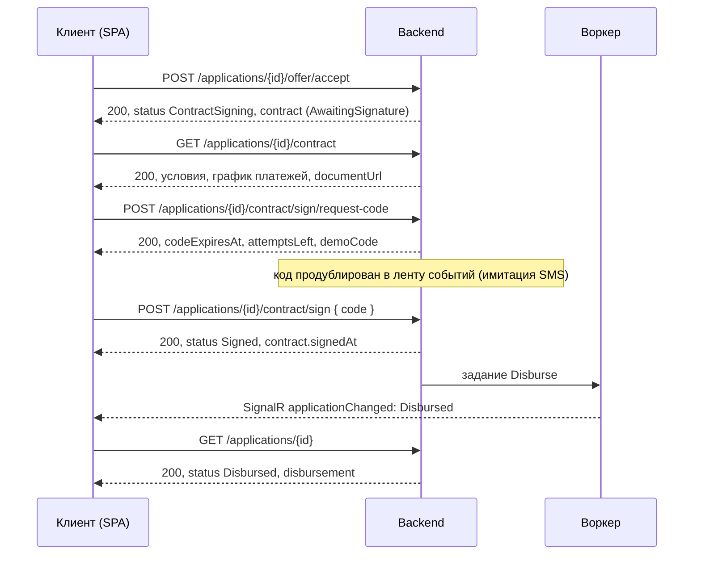

# Завершение заявки: предложение → договор → выдача

Контракт API для фронтенда. Путь клиента после одобрения заявки: принять предложение банка, проверить и подписать
договор кодом подтверждения, дождаться зачисления средств. Подписание и выдача **моделируются**: код приходит
в ленту событий кабинета (SMS и email запрещены кейсом), «зачисление» выполняет симулятор банковского ядра.

Все методы под `/api`, JSON, `Authorization: Bearer <JWT>`. Ошибки в формате ProblemDetails (RFC 9457), см. `docs/api.md`.
Изменения статуса приходят и через SignalR (`/hubs/applications`, событие `applicationChanged`).

## Путь и статусы



| Статус | `progressStep` | Терминальный | `availableActions` клиента | Что показать |
|---|---|---|---|---|
| `Approved`, `ApprovedWithConditions` | 4 | нет | `acceptOffer`, `declineOffer` | предложение (`offer`), кнопки принять/отклонить |
| `ContractSigning` | 5 | нет | `signContract`, `cancel` | договор (`contract`), график, ссылка на печатную форму, запрос кода и ввод кода |
| `Signed` | 5 | нет | нет | «Договор подписан, выполняется выдача», обычно несколько секунд |
| `Disbursed` | 6 | да | нет | реквизиты выдачи (`disbursement`), график платежей |
| `Cancelled` | 0 | да | нет | клиент отказался от подписания или истёк срок подписания (5 дней) |

Тексты статусов (`title`, `description`, `clientNextAction`) берутся из `GET /api/applications/statuses`,
кнопки строятся по `availableActions`, а не по копии правил на фронтенде. Действие `signContract` выполняется
двумя запросами: запрос кода и подтверждение кодом; текущий шаг виден в `contract.signing`.

## Новые поля в `GET /api/applications/{id}`

К заявке добавляются `contract` (краткая карточка договора, `null` до принятия предложения)
и `disbursement` (`null` до выдачи). Остальные поля (`status`, `history`, `decision`, `offer`, `availableActions`) не меняются.

```json
{
  "status": { "code": "Signed", "title": "Договор подписан", "progressStep": 5, "totalSteps": 6, "...": "..." },
  "availableActions": [],
  "offer": { "response": "Accepted", "...": "..." },
  "contract": {
    "id": "01a1b2c3-...",
    "number": "KD-000001",
    "status": "Signed",
    "amount": 1500000,
    "termMonths": 12,
    "interestRate": 19.5,
    "monthlyPayment": 138593.06,
    "totalPayment": 1663116.74,
    "totalInterest": 163116.74,
    "disbursementAccount": "40702810900000012345",
    "createdAt": "2026-10-23T09:00:00+00:00",
    "signingDeadline": "2026-10-28T09:00:00+00:00",
    "signedAt": "2026-10-23T09:02:10+00:00",
    "signing": { "codeRequestedAt": "2026-10-23T09:01:40+00:00", "codeExpiresAt": "2026-10-23T09:11:40+00:00", "attemptsLeft": 4, "canRequestCode": false },
    "documentUrl": "/api/applications/01a15975-f14b-7636-a356-687331e9eb8d/contract/document"
  },
  "disbursement": null
}
```

| Поле `contract` | Описание |
|---|---|
| `status` | `AwaitingSignature` ожидает подписи; `Signed` подписан; `Expired` истёк срок подписания; `Cancelled` клиент отказался |
| `amount`, `termMonths`, `interestRate`, `monthlyPayment` | условия из принятого предложения, ₽ и % годовых |
| `totalPayment`, `totalInterest` | сумма всех платежей по графику и переплата, ₽ |
| `disbursementAccount` | расчётный счёт компании для зачисления (20 цифр, синтетический) |
| `signingDeadline` | до какого момента можно подписать; после него заявка переходит в `Cancelled` |
| `signing.codeRequestedAt`, `signing.codeExpiresAt` | когда запрошен код и до какого момента он действует (10 минут); `null`, если код не запрашивали |
| `signing.attemptsLeft` | сколько попыток ввода осталось для текущего кода (всего 5); новый код сбрасывает счётчик |
| `signing.canRequestCode` | `true`, пока договор ожидает подписи и срок не истёк |
| `documentUrl` | печатная форма договора, HTML |

```json
{
  "status": { "code": "Disbursed", "title": "Средства выданы", "progressStep": 6, "isTerminal": true, "...": "..." },
  "contract": { "number": "KD-000001", "status": "Signed", "...": "..." },
  "disbursement": {
    "id": "01a1b2c4-...",
    "amount": 1500000,
    "account": "40702810900000012345",
    "paymentOrderNumber": "PO-20261023-4821",
    "status": "Completed",
    "requestedAt": "2026-10-23T09:02:12+00:00",
    "completedAt": "2026-10-23T09:02:13+00:00",
    "error": null
  }
}
```

| Поле `disbursement` | Описание |
|---|---|
| `status` | `Completed` средства зачислены; `Failed` симулятор банковского ядра не принял платёж (после трёх попыток заявка остаётся в `Signed`, менеджер получает событие) |
| `paymentOrderNumber` | номер платёжного поручения из симулятора |
| `requestedAt`, `completedAt` | когда выдача начата и завершена (UTC) |

## Запросы

### POST /api/applications/{id}/offer/accept

Без изменений, роль `Client`, тела нет. Статусы `Approved` и `ApprovedWithConditions`, пока предложение действует.
Ответ 200: заявка со статусом `ContractSigning`, `offer.response` = `Accepted`, сформированный `contract`
со статусом `AwaitingSignature`, `availableActions` = `["signContract", "cancel"]`.
В ленту приходит событие `ContractReady` «Договор № KD-000001 готов к подписанию».

| Код | Когда |
|---|---|
| 409 | предложения нет, оно уже принято или отклонено, срок предложения истёк |

### GET /api/applications/{id}/contract

Роли `Client` (своя компания), `Manager`, `Admin`. Полный договор: стороны, условия, подпись и график платежей.

```json
{
  "id": "01a1b2c3-...",
  "number": "KD-000001",
  "status": "AwaitingSignature",
  "applicationId": "01a15975-f14b-7636-a356-687331e9eb8d",
  "applicationNumber": "AC-000001",
  "lender": { "name": "AlfaCredit (демонстрационный банк)" },
  "borrower": {
    "companyId": "01a15975-ea5f-7a4f-863b-9035b3b8b2ca",
    "name": "ООО «Ромашка»",
    "inn": "7701234567",
    "ogrn": "1157746123456",
    "address": "Москва, ул. Садовая, д. 12",
    "headName": "Иванова Мария Сергеевна"
  },
  "product": { "code": "working-capital", "name": "Оборотный кредит" },
  "purpose": "WorkingCapital",
  "purposeTitle": "Пополнение оборотных средств",
  "amount": 1500000,
  "termMonths": 12,
  "interestRate": 19.5,
  "monthlyPayment": 138593.06,
  "totalPayment": 1663116.74,
  "totalInterest": 163116.74,
  "disbursementAccount": "40702810900000012345",
  "createdAt": "2026-10-23T09:00:00+00:00",
  "signingDeadline": "2026-10-28T09:00:00+00:00",
  "signedAt": null,
  "signedBy": null,
  "signatureMethod": null,
  "signing": { "codeRequestedAt": null, "codeExpiresAt": null, "attemptsLeft": 5, "canRequestCode": true },
  "schedule": [
    { "number": 1, "dueDate": "2026-11-23", "payment": 138593.06, "principal": 114218.06, "interest": 24375.00, "balance": 1385781.94 },
    { "number": 2, "dueDate": "2026-12-23", "payment": 138593.06, "principal": 116074.10, "interest": 22518.96, "balance": 1269707.84 },
    { "number": 12, "dueDate": "2027-10-23", "payment": 138593.08, "principal": 136376.95, "interest": 2216.13, "balance": 0 }
  ],
  "documentUrl": "/api/applications/01a15975-f14b-7636-a356-687331e9eb8d/contract/document"
}
```

- `schedule`: аннуитетный график, по одной строке на месяц; `dueDate` ориентировочная: через месяц после выдачи,
  до выдачи от даты формирования договора. Последний платёж скорректирован так, чтобы `balance` стал ровно 0.
- После подписания заполняются `signedAt`, `signedBy` (`{ "userId", "fullName" }`) и `signatureMethod`
  («Простая электронная подпись: код подтверждения из кабинета (имитация SMS)»).

| Код | Когда |
|---|---|
| 404 | договор ещё не сформирован: заявка не дошла до принятия предложения |
| 403 | заявка другой компании |

### GET /api/applications/{id}/contract/document

Те же роли. Ответ `200 text/html; charset=utf-8`: печатная форма договора (стороны, условия, график, блок подписи).
Открывается в новой вкладке или во `<iframe>`; токен передаётся заголовком, поэтому фронтенд скачивает документ
через `fetch` и показывает как `Blob`. Ошибки те же, что у `GET /contract`.

### POST /api/applications/{id}/contract/sign/request-code

Роль `Client`, тела нет. Создаёт код подтверждения и доставляет его в ленту событий (тип `SigningCode`,
текст «Код подтверждения для подписания договора KD-000001: 483921. Действует 10 минут»). Повторный запрос
выдаёт новый код и сбрасывает счётчик попыток.

```json
{
  "contractNumber": "KD-000001",
  "deliveredVia": "Feed",
  "codeExpiresAt": "2026-10-23T09:11:40+00:00",
  "attemptsLeft": 5,
  "demoCode": "483921"
}
```

`demoCode` присутствует только в демо-режиме (`Contracts__RevealCodeInResponse=true`, значение по умолчанию),
чтобы сценарий можно было пройти без ленты; при выключенной настройке поле равно `null`.

| Код | Когда |
|---|---|
| 409 | заявка не в статусе `ContractSigning`; срок подписания истёк |
| 403 | не клиент или чужая компания |

### POST /api/applications/{id}/contract/sign

Роль `Client`. Тело:

```json
{ "code": "483921" }
```

| Поле | Тип | Правила |
|---|---|---|
| `code` | string | обязательно, 6 цифр |

Ответ 200: заявка в формате `GET /api/applications/{id}` со статусом `Signed`, `contract.status` = `Signed`,
заполненными `contract.signedAt`, записью в `history` («Договор подписан простой электронной подписью»)
и пустым `availableActions`. Через `Processing__StageDelaySeconds` (2 секунды) воркер выполняет выдачу,
статус становится `Disbursed`, появляется `disbursement`.

| Код | Когда | Что в ответе |
|---|---|---|
| 400 | код не передан или не 6 цифр | `errors.code` |
| 400 | код неверный | `errors.code` = «Неверный код подтверждения. Осталось попыток: 4» |
| 409 | код не запрашивали, срок кода истёк, попытки исчерпаны: нужно запросить новый код | `detail` с объяснением |
| 409 | заявка не в статусе `ContractSigning` или срок подписания истёк | `detail` |

### POST /api/applications/{id}/cancel

Теперь доступно и в статусе `ContractSigning`: клиент отказывается от подписания. Заявка переходит в `Cancelled`,
`contract.status` = `Cancelled`. Тело необязательно (`{ "reason": "..." }`).

## События ленты (`GET /api/feed`)

| `type` | Когда | Кому |
|---|---|---|
| `ContractReady` | предложение принято, договор сформирован | представителям компании |
| `SigningCode` | запрошен код подтверждения; в `body` сам код и срок действия | представителям компании |
| `ContractSigned` | договор подписан | представителям компании и менеджерам |
| `Disbursed` | средства зачислены; в `body` сумма, счёт и номер платёжного поручения | представителям компании и менеджерам |
| `StatusChanged` | отказ от подписания или истечение срока подписания | представителям компании |

## Что ещё знать фронтенду

- Все суммы в рублях числом с копейками (`138593.06`), ставка в процентах годовых (`19.5`), даты и время в UTC ISO 8601.
- `GET /api/applications/{id}` всегда возвращает `contract` и `disbursement` (как `null`, пока их нет), поэтому проверка на `null` достаточна.
- Срок подписания 5 дней (`Contracts__SigningDays`), код действует 10 минут (`Contracts__CodeTtlMinutes`), попыток 5 (`Contracts__CodeMaxAttempts`).
- Демо-сценарий в Swagger: войти как `client_good`, подать `working-capital` на 1 500 000 ₽ на 12 мес, дождаться `Approved`,
  принять предложение, запросить код, подписать кодом из ответа, через пару секунд увидеть `Disbursed`.
- Менеджер (`manager`) видит договор и документ, но подписывать не может (403).
