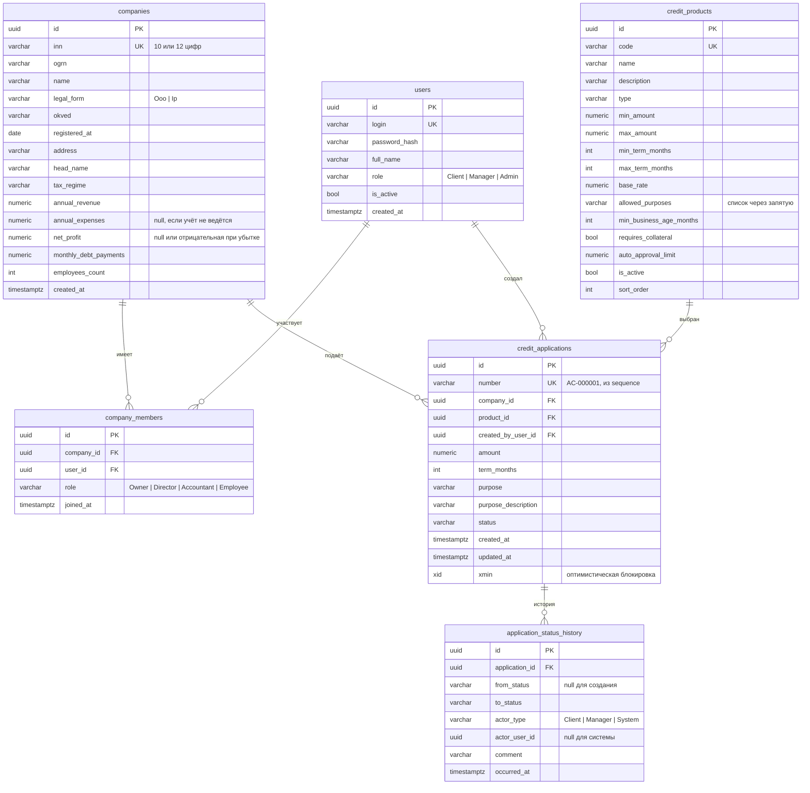

# Модель данных

PostgreSQL 16, схема управляется миграциями EF Core (`src/AlfaCredit.Infrastructure/Persistence/Migrations`).
Имена таблиц и столбцов в snake_case, перечисления хранятся строками для читаемости в базе.
Идентификаторы: UUID v7 (упорядочены по времени, дружелюбны к индексам).

## Замечания по проектированию

- **Номер заявки** генерируется базой из последовательности `application_number_seq` при вставке,
  поэтому он уникален при любом числе экземпляров API.
- **Оптимистическая блокировка** через системный столбец `xmin`: при одновременном изменении одной заявки
  второй запрос получает конфликт, а не затирает решение первого.
- **История статусов** пишется при каждом переходе и служит одновременно таймлайном для клиента и аудитом для банка.
- **Цели продукта** хранятся строкой `WorkingCapital,Other`: справочник маленький и стабильный, отдельная таблица не нужна.
- **Индексы**: `credit_applications (company_id, created_at)` для кабинета клиента, `credit_applications (status)` для очереди банка,
  `application_status_history (application_id, occurred_at)` для таймлайна.
- Следующие этапы добавят таблицы документов, запросов на уточнение, внешних проверок, скоринга, решений, договоров,
  выдач, ленты событий и очереди заданий конвейера; см. `backend-plan.md`.
