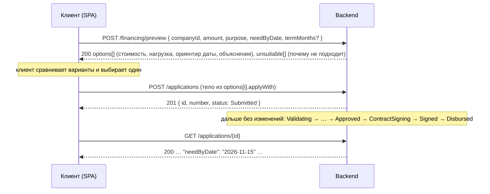

# Предварительный подбор финансирования: `POST /api/financing/preview`

Контракт API для нового интерфейса «Нужны деньги к дате». Клиент отвечает на три вопроса (на что, сколько, к какому дню),
backend показывает, какие продукты подходят, во что обойдётся каждый вариант и успеют ли деньги к нужной дате.
Выбранный вариант отправляется как обычная заявка: действующий конвейер (обработка → решение → предложение → договор →
подписание → выдача) не меняется, к заявке добавляется только поле `needByDate`.

Preview **не создаёт заявку и ничего не сохраняет**: его можно вызывать сколько угодно раз, меняя сумму и дату.
Все методы под `/api`, JSON, `Authorization: Bearer <JWT>`, ошибки в формате ProblemDetails (см. `docs/api.md`).

**Версия контракта 2 (24.10.2026), окончательная для фронта.** Отличия от версии 1 собраны в разделе «Изменения версии 2» в конце.
Расчёт не является одобрением и не гарантирует выдачу: это предварительный подбор по данным кабинета.

## Путь клиента



| Шаг интерфейса (юзерфлоу) | Запрос | Что показать |
|---|---|---|
| «Ответить на 3 вопроса: на что, сколько, к какому дню» | `POST /api/financing/preview` | форма: компания из `GET /api/companies`, сумма, цель, дата, необязательный срок |
| «Совет с учётом даты: какой кредит успеет и какая переплата» | ответ preview | карточки `options[]`: платёж, переплата, ориентир даты, `isRecommended` |
| «Сравнить варианты» | тот же ответ | `cost`, `affordability` («потяну ли платёж»), `funding` («успею ли к дате»), `explanations`, `limitations`, `requirements` («что нужно для оформления») |
| «Вариантов нет» | ответ с пустым `options` | `summary` и `unsuitable[].reasons` простыми словами: что изменить, чтобы вариант появился |
| «Подаёт сейчас» | `POST /api/applications` с `options[i].applyWith` | дальше карточка заявки как сейчас |

## Запрос

```json
{
  "companyId": "01a15975-ea5f-7a4f-863b-9035b3b8b2ca",
  "amount": 1500000,
  "purpose": "WorkingCapital",
  "needByDate": "2026-11-15",
  "termMonths": 12
}
```

| Поле | Тип | Обязательно | Правила |
|---|---|---|---|
| `companyId` | uuid | да | своя компания (клиент); сотрудник банка может считать для любой |
| `amount` | number | да | > 0, не больше 1 000 000 000; сравнивается с границами каждого продукта |
| `purpose` | enum | да | `WorkingCapital`, `Equipment`, `Expansion`, `Refinancing`, `Other` |
| `needByDate` | date `YYYY-MM-DD` | да | к какой дате нужны деньги: не раньше сегодняшнего дня по московскому календарю (UTC+3) и не позже чем через 2 года |
| `termMonths` | int | нет | 1..120. Если указан, продукты с другим диапазоном сроков попадают в `unsuitable`. Если не указан, срок подбирается для каждого продукта (см. ниже) |

«Сегодня» для всех расчётов (возраст бизнеса, дни до нужной даты, ориентиры сроков, проверка `needByDate`) — календарная дата по Москве;
она возвращается в `calculationDate`. То же правило действует при создании заявки.

| Код | Когда | Тело |
|---|---|---|
| 200 | расчёт выполнен, в том числе когда подходящих вариантов нет (`options` пустой) | см. ниже |
| 400 | ошибка валидации: `errors.amount`, `errors.purpose`, `errors.needByDate` («не может быть раньше сегодняшнего дня»), `errors.termMonths`, `errors.companyId` («Компания не найдена.») | ProblemDetails с `errors` |
| 401 | нет токена | |
| 403 | клиент не представитель компании | `title`, `detail` |

## Ответ

ООО «Ромашка» (`client_good`), 1 500 000 ₽ на пополнение оборотных средств к 15.11.2026, срок 12 мес., расчёт 24.10.2026.
Сравниваются только срочные продукты с аннуитетным графиком: подходят «Оборотный кредит» и «Экспресс-кредит»;
«Овердрафт» и «Кредитная линия» вне сравнения (`notCompared`); «Инвестиционный кредит» не подходит по цели (`unsuitable`).

```json
{
  "calculatedAt": "2026-10-24T12:06:39.7974907+00:00",
  "calculationDate": "2026-10-24",
  "company": {
    "id": "01a16d82-bea0-7edd-9a95-4a3900d0cb9c",
    "name": "ООО «Ромашка»",
    "inn": "7701234567",
    "businessAgeMonths": 91
  },
  "request": {
    "amount": 1500000,
    "purpose": "WorkingCapital",
    "purposeTitle": "Пополнение оборотных средств",
    "needByDate": "2026-11-15",
    "daysUntilNeeded": 22,
    "termMonths": 12
  },
  "summary": "Подходят 2 варианта из 3 сравниваемых продуктов. Рекомендуем «Оборотный кредит»: платёж 138 593 ₽ в месяц, переплата 163 117 ₽ за 12 мес., при одобрении деньги ориентировочно 26.10.2026, к нужной дате успеваем.",
  "disclaimer": "Предварительный расчёт по базовым ставкам продуктов и данным компании из кабинета: не является одобрением и не гарантирует выдачу. Точные условия банк назначает после проверки заявки: ставка зависит от оценки риска, сумма может быть снижена. Заявка не создана.",
  "options": [
    {
      "productCode": "working-capital",
      "productName": "Оборотный кредит",
      "productType": "WorkingCapital",
      "isRecommended": true,
      "amount": 1500000,
      "termMonths": 12,
      "termSuggested": false,
      "termRange": {
        "min": 3,
        "max": 24
      },
      "cost": {
        "interestRate": 19.5,
        "maxInterestRate": 22.5,
        "monthlyPayment": 138593.06,
        "maxMonthlyPayment": 140752.78,
        "totalPayment": 1663116.74,
        "totalInterest": 163116.74,
        "maxTotalInterest": 189033.3
      },
      "affordability": {
        "monthlyProfit": 600000.0,
        "currentDebtPayments": 150000.0,
        "debtLoad": 0.48,
        "level": "Moderate",
        "profitBasis": "NetProfit",
        "explanation": "Платёж 138 593 ₽ вместе с текущими платежами 150 000 ₽ составит 48 % месячной прибыли 600 000 ₽: заметная, но посильная нагрузка (30–50 %)."
      },
      "funding": {
        "decisionPath": "Auto",
        "businessDays": 1,
        "expectedDate": "2026-10-26",
        "inTime": true,
        "explanation": "Сумма в пределах лимита автоматического решения 5 000 000 ₽: при чистых проверках и хорошей оценке решение принимается без менеджера. При одобрении и подписании договора деньги ориентировочно 26.10.2026, до нужной даты 15.11.2026 остаётся 20 дней. Ориентир не является одобрением."
      },
      "suggestedAmount": null,
      "explanations": [
        {
          "code": "product_about",
          "text": "Пополнение оборотных средств: закупка товара и сырья, сезонные расходы, кассовые разрывы. Без залога, по большинству заявок решение принимается автоматически."
        },
        {
          "code": "no_collateral",
          "text": "Без залога."
        },
        {
          "code": "auto_decision_possible",
          "text": "Сумма в пределах лимита автоматического решения 5 000 000 ₽: при чистых проверках и хорошей оценке решение принимается без менеджера, иначе заявку рассмотрит менеджер."
        },
        {
          "code": "data_prefilled",
          "text": "Выручка, налоги и реквизиты подгружаются из кабинета автоматически, вводить их не нужно."
        },
        {
          "code": "checks_automatic",
          "text": "После подачи банк сам запросит сведения ЕГРЮЛ, ФНС, кредитную историю и ФССП (на стенде это симуляторы); отдельных документов и согласий в кабинете не требуется."
        },
        {
          "code": "cheapest",
          "text": "Самая низкая переплата среди подходящих вариантов."
        }
      ],
      "limitations": [
        {
          "code": "rate_depends_on_risk",
          "text": "Ставка от 19,5 % до 22,5 % годовых: точную ставку банк назначает после оценки риска."
        }
      ],
      "requirements": [],
      "applyWith": {
        "companyId": "01a16d82-bea0-7edd-9a95-4a3900d0cb9c",
        "productCode": "working-capital",
        "amount": 1500000,
        "termMonths": 12,
        "purpose": "WorkingCapital",
        "needByDate": "2026-11-15"
      }
    },
    {
      "productCode": "express",
      "productName": "Экспресс-кредит",
      "productType": "Express",
      "isRecommended": false,
      "amount": 1500000,
      "termMonths": 12,
      "termSuggested": false,
      "termRange": {
        "min": 3,
        "max": 18
      },
      "cost": {
        "interestRate": 23.0,
        "maxInterestRate": 26.0,
        "monthlyPayment": 141114.48,
        "maxMonthlyPayment": 143295.21,
        "totalPayment": 1693373.8,
        "totalInterest": 193373.8,
        "maxTotalInterest": 219542.51
      },
      "affordability": {
        "monthlyProfit": 600000.0,
        "currentDebtPayments": 150000.0,
        "debtLoad": 0.49,
        "level": "Moderate",
        "profitBasis": "NetProfit",
        "explanation": "…"
      },
      "funding": {
        "decisionPath": "Auto",
        "businessDays": 1,
        "expectedDate": "2026-10-26",
        "inTime": true,
        "explanation": "…"
      },
      "suggestedAmount": null,
      "explanations": [
        "…"
      ],
      "limitations": [
        {
          "code": "rate_depends_on_risk",
          "text": "Ставка от 23 % до 26 % годовых: точную ставку банк назначает после оценки риска."
        }
      ],
      "requirements": [],
      "applyWith": {
        "companyId": "01a16d82-bea0-7edd-9a95-4a3900d0cb9c",
        "productCode": "express",
        "amount": 1500000,
        "termMonths": 12,
        "purpose": "WorkingCapital",
        "needByDate": "2026-11-15"
      }
    }
  ],
  "notCompared": [
    {
      "productCode": "overdraft",
      "productName": "Овердрафт",
      "productType": "Overdraft",
      "reason": {
        "code": "limit_product",
        "text": "«Овердрафт»: лимит к расчётному счёту, проценты начисляются только за дни использования. Платёж и переплата по аннуитетной модели не считаются; оформляется отдельной заявкой из каталога."
      }
    },
    {
      "productCode": "credit-line",
      "productName": "Кредитная линия",
      "productType": "CreditLine",
      "reason": {
        "code": "limit_product",
        "text": "«Кредитная линия»: возобновляемый лимит, транши выбираются по мере необходимости. Платёж и переплата по аннуитетной модели не считаются; оформляется отдельной заявкой из каталога."
      }
    }
  ],
  "unsuitable": [
    {
      "productCode": "investment",
      "productName": "Инвестиционный кредит",
      "reasons": [
        {
          "code": "purpose_not_allowed",
          "text": "Цель «Пополнение оборотных средств» недоступна. Доступные цели: «Покупка оборудования или транспорта», «Расширение бизнеса», «Рефинансирование кредитов»."
        }
      ],
      "suggestedAmount": null
    }
  ]
}
```

Примеры в этом документе сняты с запущенного стенда (seed, расчёт 23.10.2026) и сокращены: `"…"` обозначает
опущенные поля. Полные ответы для любого демо-клиента можно получить запросами из `docs/requests.http`.

### Поля ответа

| Поле | Описание |
|---|---|
| `calculatedAt` | момент расчёта (UTC); ответ не сохраняется, повторный запрос считается заново |
| `calculationDate` | календарная дата расчёта по Москве: от неё считаются возраст бизнеса, `daysUntilNeeded` и ориентиры сроков |
| `company` | компания из запроса; `businessAgeMonths` на дату расчёта |
| `request` | эхо запроса: `purposeTitle` для интерфейса, `daysUntilNeeded` дней от сегодня до `needByDate`, `termMonths` как в запросе (`null`, если не указан) |
| `summary` | одна фраза для заголовка: сколько вариантов, какой рекомендован и почему, либо почему вариантов нет |
| `disclaimer` | текст-оговорка под расчётом; выводится как есть: расчёт не является одобрением и не гарантирует выдачу |
| `options[]` | подходящие срочные продукты (типы `WorkingCapital`, `Express`, `Investment`), отсортированы: сначала те, что успевают к дате, затем по возрастанию переплаты; первый помечен `isRecommended` |
| `notCompared[]` | продукты с лимитом (`Overdraft`, `CreditLine`): по аннуитетной модели не сравниваются, `reason.code` = `limit_product`; оформляются обычной заявкой из каталога |
| `unsuitable[]` | продукты, которые не подходят, с причинами по кодам (таблица ниже) и `suggestedAmount` (`basis` = `ProductMaximum`), если мешает только сумма; пустой, если подходят все |

| Поле `options[]` | Описание |
|---|---|
| `productCode`, `productName`, `productType` | продукт из `GET /api/products` |
| `amount` | сумма из запроса, ₽ |
| `termMonths`, `termSuggested`, `termRange` | срок расчёта; `termSuggested` = `true`, если срок не был указан и подобран системой (см. правила); `termRange` границы продукта, чтобы интерфейс дал поправить срок |
| `cost.interestRate` | базовая ставка продукта, % годовых: ставка при низком риске (грейд A) |
| `cost.maxInterestRate` | базовая ставка + 3 п.п.: верхняя граница при автоматическом одобрении (грейд C) |
| `cost.monthlyPayment`, `cost.totalPayment`, `cost.totalInterest` | аннуитетный платёж, сумма всех платежей и переплата при `interestRate`, ₽ |
| `cost.maxMonthlyPayment`, `cost.maxTotalInterest` | то же при `maxInterestRate`: интерфейс показывает «от … до …» |
| `affordability.monthlyProfit` | месячная прибыль компании, по которой считается нагрузка, ₽; `null`, если данных недостаточно |
| `affordability.currentDebtPayments` | текущие ежемесячные платежи по кредитам и лизингу из карточки компании, ₽ |
| `affordability.debtLoad` | (текущие платежи + новый платёж) / месячная прибыль, доля с двумя знаками, не больше 9.99; `null`, если прибыли нет или данных недостаточно |
| `affordability.level` | `Comfortable` (< 30 %), `Moderate` (30–50 %), `Elevated` (50–70 %: оценка риска снижается), `High` (≥ 70 % или нет прибыли), `InsufficientData` (в карточке нет ни чистой прибыли, ни расходов: оценка не выдаётся, остальные поля `affordability` равны `null`). Банды те же, что у фактора `debt_load` правил скоринга `rules-0.3` (+10 / 0 / −10 / −25 баллов) |
| `affordability.profitBasis` | откуда прибыль: `NetProfit` (чистая прибыль за 12 мес.), `RevenueMinusExpenses` (выручка минус расходы); `null` при `InsufficientData`. Оценка по доле выручки не выдаётся |
| `affordability.explanation` | фраза для клиента |
| `funding.decisionPath` | `Auto`: сумма в лимите автоматического решения и залог не нужен, при чистых проверках и хорошей оценке решение без менеджера (не гарантия); `ManualReview`: заявку в любом случае рассматривает менеджер |
| `funding.businessDays`, `funding.expectedDate` | ориентир при положительном решении: через сколько рабочих дней после подачи деньги обычно на счёте и какая это дата. Не является одобрением и не гарантирует выдачу |
| `funding.inTime` | `expectedDate` не позже `needByDate` |
| `funding.explanation` | фраза для клиента: почему такой срок и успеваем ли; заканчивается словами «Ориентир не является одобрением.» |
| `suggestedAmount` | меньшая сумма для повторного расчёта или `null`: `amount` (₽), `basis` (`AutoApprovalLimit`, `RevenueShare`, `DebtLoad`), `text` (обоснование). Условия появления в разделе «Меньшая сумма» |
| `explanations[]` | почему вариант подходит и что в нём важно: `product_about`, `no_collateral`, `auto_decision_possible` (лимит не гарантирует автоматическое решение), `term_suggested`, `data_prefilled`, `checks_automatic` (ЕГРЮЛ, ФНС, БКИ, ФССП банк запрашивает сам, отдельных согласий в кабинете нет), `cheapest` (у варианта с минимальной переплатой) |
| `limitations[]` | что может изменить условия или срок: `rate_depends_on_risk`, `manual_review_amount`, `collateral_required`, `amount_may_be_reduced` (сумма выше 25 % годовой выручки), `expense_ratio_high` (расходы больше 90 % выручки), `affordability_unknown` (данных для оценки нагрузки нет), `elevated_debt_load`, `high_debt_load`, `deadline_missed` |
| `requirements[]` | что действительно потребуется (только реализованные проверки): `financials_required` (расходы и чистая прибыль за 12 мес. для сумм выше 3 000 000 ₽ и инвестиционного кредита, если их нет в карточке: этап Validate остановит заявку), `collateral_documents` (менеджер запросит при залоге). Отдельного согласия на запрос кредитной истории в кабинете нет, внешние проверки выполняются автоматически |
| `applyWith` | готовое тело для `POST /api/applications`: продукт, сумма, срок, цель и `needByDate`; интерфейс отправляет его без изменений |

Все элементы `explanations`, `limitations`, `requirements` и `unsuitable[].reasons` имеют вид `{ "code", "text" }`:
текст показывается как есть, код нужен для иконок и тестов.

| Код причины `unsuitable[].reasons` | Когда |
|---|---|
| `purpose_not_allowed` | цель не входит в допустимые цели продукта; в тексте перечислены доступные |
| `amount_below_min`, `amount_above_max` | сумма вне границ продукта; в тексте граница |
| `term_out_of_range` | указанный `termMonths` вне границ продукта; в тексте диапазон |
| `business_too_young` | возраст бизнеса меньше минимального для продукта; в тексте оба значения |
| `product_inactive` | продукт отключён администратором |

### Вариантов нет

ИП Петрова (`client_new`, бизнесу 4 месяца), 500 000 ₽ на оборотные средства. `summary` собирает одинаковые причины
разных продуктов в одну фразу; продукты с лимитом остаются в `notCompared`:

```json
{
  "calculatedAt": "2026-10-24T12:06:40.5543707+00:00",
  "calculationDate": "2026-10-24",
  "company": {
    "id": "01a16d82-bec9-7cca-9349-944589235d86",
    "name": "ИП Петрова Елена Викторовна",
    "inn": "772812345678",
    "businessAgeMonths": 4
  },
  "request": {
    "amount": 500000,
    "purpose": "WorkingCapital",
    "purposeTitle": "Пополнение оборотных средств",
    "needByDate": "2026-12-01",
    "daysUntilNeeded": 38,
    "termMonths": null
  },
  "summary": "Подходящих продуктов нет. Возраст бизнеса 4 мес., для продукта требуется не менее 12 мес. Продукт: «Оборотный кредит». Возраст бизнеса 4 мес., для продукта требуется не менее 6 мес. Продукт: «Экспресс-кредит». Цель «Пополнение оборотных средств» недоступна. Доступные цели: «Покупка оборудования или транспорта», «Расширение бизнеса», «Рефинансирование кредитов». Продукт: «Инвестиционный кредит». Минимальная сумма продукта 1 000 000 ₽. Продукт: «Инвестиционный кредит». Возраст бизнеса 4 мес., для продукта требуется не менее 24 мес. Продукт: «Инвестиционный кредит». Продукты с лимитом («Овердрафт», «Кредитная линия») в сравнение не входят и оформляются отдельной заявкой.",
  "disclaimer": "Предварительный расчёт по базовым ставкам продуктов и данным компании из кабинета: не является одобрением и не гарантирует выдачу. Точные условия банк назначает после проверки заявки: ставка зависит от оценки риска, сумма может быть снижена. Заявка не создана.",
  "options": [],
  "notCompared": [
    {
      "productCode": "overdraft",
      "productName": "Овердрафт",
      "productType": "Overdraft",
      "reason": {
        "code": "limit_product",
        "text": "«Овердрафт»: лимит к расчётному счёту, проценты начисляются только за дни использования. Платёж и переплата по аннуитетной модели не считаются; оформляется отдельной заявкой из каталога."
      }
    },
    {
      "productCode": "credit-line",
      "productName": "Кредитная линия",
      "productType": "CreditLine",
      "reason": {
        "code": "limit_product",
        "text": "«Кредитная линия»: возобновляемый лимит, транши выбираются по мере необходимости. Платёж и переплата по аннуитетной модели не считаются; оформляется отдельной заявкой из каталога."
      }
    }
  ],
  "unsuitable": [
    {
      "productCode": "working-capital",
      "productName": "Оборотный кредит",
      "reasons": [
        {
          "code": "business_too_young",
          "text": "Возраст бизнеса 4 мес., для продукта требуется не менее 12 мес."
        }
      ],
      "suggestedAmount": null
    },
    {
      "productCode": "express",
      "productName": "Экспресс-кредит",
      "reasons": [
        {
          "code": "business_too_young",
          "text": "Возраст бизнеса 4 мес., для продукта требуется не менее 6 мес."
        }
      ],
      "suggestedAmount": null
    },
    {
      "productCode": "investment",
      "productName": "Инвестиционный кредит",
      "reasons": [
        {
          "code": "purpose_not_allowed",
          "text": "Цель «Пополнение оборотных средств» недоступна. Доступные цели: «Покупка оборудования или транспорта», «Расширение бизнеса», «Рефинансирование кредитов»."
        },
        {
          "code": "amount_below_min",
          "text": "Минимальная сумма продукта 1 000 000 ₽."
        },
        {
          "code": "business_too_young",
          "text": "Возраст бизнеса 4 мес., для продукта требуется не менее 24 мес."
        }
      ],
      "suggestedAmount": null
    }
  ]
}
```

### Ручное рассмотрение, залог и дата, к которой не успеть

ООО «Вектор» (`client_manual`), 5 000 000 ₽ на оборудование к 02.11.2026 без срока. Подходит только «Инвестиционный кредит»
(залог, менеджер, 10 рабочих дней: ориентир 06.11.2026 позже нужной даты, срок взят максимальный, потому что нагрузка высокая
при любом сроке). «Экспресс-кредиту» мешает только сумма, поэтому у него есть `suggestedAmount` с максимумом продукта;
«Кредитная линия» подошла бы по цели, но как продукт с лимитом в сравнение не входит:

```json
{
  "options": [
    {
      "productCode": "investment",
      "isRecommended": true,
      "termMonths": 84,
      "termSuggested": true,
      "termRange": {
        "min": 12,
        "max": 84
      },
      "cost": {
        "interestRate": 17.5,
        "maxInterestRate": 20.5,
        "monthlyPayment": 103628.97,
        "maxMonthlyPayment": 112541.21,
        "totalPayment": 8704833.32,
        "totalInterest": 3704833.32,
        "maxTotalInterest": 4453461.34
      },
      "affordability": {
        "monthlyProfit": 1333333.33,
        "currentDebtPayments": 1200000.0,
        "debtLoad": 0.98,
        "level": "High",
        "profitBasis": "NetProfit",
        "explanation": "…"
      },
      "funding": {
        "decisionPath": "ManualReview",
        "businessDays": 10,
        "expectedDate": "2026-11-06",
        "inTime": false,
        "explanation": "Нужен залог, заявку рассматривает кредитный менеджер. При одобрении, оформлении залога и подписании договора деньги ориентировочно 06.11.2026, это позже нужной даты 02.11.2026. Ориентир не является одобрением."
      },
      "suggestedAmount": null,
      "explanations": [
        {
          "code": "product_about",
          "text": "…"
        },
        {
          "code": "term_suggested",
          "text": "Срок 84 мес. максимальный для продукта: нагрузка остаётся высокой при любом сроке; можно выбрать от 12 до 84 мес."
        },
        {
          "code": "data_prefilled",
          "text": "…"
        },
        {
          "code": "checks_automatic",
          "text": "…"
        },
        {
          "code": "cheapest",
          "text": "…"
        }
      ],
      "limitations": [
        {
          "code": "rate_depends_on_risk",
          "text": "…"
        },
        {
          "code": "manual_review_amount",
          "text": "Сумма выше лимита автоматического решения 3 000 000 ₽: заявку рассматривает кредитный менеджер."
        },
        {
          "code": "collateral_required",
          "text": "Нужен залог: его оформление и оценка занимают до 10 рабочих дней."
        },
        {
          "code": "high_debt_load",
          "text": "…"
        },
        {
          "code": "deadline_missed",
          "text": "Ориентир получения 06.11.2026 позже нужной даты 02.11.2026."
        }
      ],
      "requirements": [
        {
          "code": "collateral_documents",
          "text": "Документы на предмет залога: менеджер запросит их при рассмотрении."
        }
      ],
      "…": "…"
    }
  ],
  "notCompared": [
    {
      "productCode": "overdraft",
      "productName": "Овердрафт",
      "productType": "Overdraft",
      "reason": {
        "code": "limit_product",
        "text": "«Овердрафт»: лимит к расчётному счёту, проценты начисляются только за дни использования. Платёж и переплата по аннуитетной модели не считаются; оформляется отдельной заявкой из каталога."
      }
    },
    {
      "productCode": "credit-line",
      "productName": "Кредитная линия",
      "productType": "CreditLine",
      "reason": {
        "code": "limit_product",
        "text": "«Кредитная линия»: возобновляемый лимит, транши выбираются по мере необходимости. Платёж и переплата по аннуитетной модели не считаются; оформляется отдельной заявкой из каталога."
      }
    }
  ],
  "unsuitable": [
    {
      "productCode": "working-capital",
      "productName": "Оборотный кредит",
      "reasons": [
        {
          "code": "purpose_not_allowed",
          "text": "…"
        }
      ],
      "suggestedAmount": null
    },
    {
      "productCode": "express",
      "productName": "Экспресс-кредит",
      "reasons": [
        {
          "code": "amount_above_max",
          "text": "Максимальная сумма продукта 3 000 000 ₽."
        }
      ],
      "suggestedAmount": {
        "amount": 3000000.0,
        "basis": "ProductMaximum",
        "text": "3 000 000 ₽: максимальная сумма продукта «Экспресс-кредит». Пересчитайте с этой суммой, и продукт попадёт в подходящие варианты."
      }
    }
  ]
}
```

## Как подбираются варианты

Сравниваются только срочные продукты с аннуитетным графиком: типы `WorkingCapital`, `Express`, `Investment`. Овердрафт и кредитная
линия — продукты с лимитом (проценты за дни использования, транши), платёж и переплата по аннуитетной модели для них не считаются:
они возвращаются в `notCompared` с объяснением и по-прежнему оформляются обычной заявкой из каталога (`POST /api/applications`
принимает любой активный продукт, старые заявки по ним не меняются).

Для срочных продуктов проверяются те же правила, что при подаче заявки (`CreditApplication.Create`),
поэтому вариант из `options` всегда проходит валидацию `POST /api/applications` с тем же телом.

| Правило | Источник | Если не выполняется |
|---|---|---|
| цель входит в `allowedPurposes` | продукт | `purpose_not_allowed` |
| сумма в `minAmount..maxAmount` | продукт | `amount_below_min` / `amount_above_max` |
| срок в `minTermMonths..maxTermMonths` (только если `termMonths` указан) | продукт | `term_out_of_range` |
| возраст бизнеса ≥ `minBusinessAgeMonths` (полных месяцев с даты регистрации на дату расчёта) | компания | `business_too_young` |
| продукт активен | продукт | `product_inactive` |

**Срок, если не указан.** Для каждого продукта берётся самый короткий срок из его диапазона, при котором нагрузка
(`affordability.debtLoad`) меньше 30 % (комфортная); если такого нет, самый короткий с нагрузкой меньше 50 % (без штрафа
в скоринге); затем меньше 70 %; если и такого нет, максимальный срок продукта (нагрузка остаётся высокой, об этом говорит
`high_debt_load`). Если данных для оценки нагрузки нет (`InsufficientData`), берётся максимальный срок продукта как срок
с минимальным платежом; объяснение `term_suggested` говорит, по какому правилу выбран срок. Короткий срок даёт минимальную
переплату, порог нагрузки защищает от неподъёмного платежа и от штрафа в оценке риска. Клиент может выбрать любой срок из `termRange`
и пересчитать preview с `termMonths`.

**Сортировка и рекомендация.** Сначала варианты с `funding.inTime` = `true`, внутри группы по возрастанию `cost.totalInterest`,
при равенстве по порядку витрины. Первый вариант получает `isRecommended` = `true` и объяснение `cheapest`, если его переплата минимальна.

## Как считается стоимость

Все суммы считает сервер; интерфейс ничего не пересчитывает.

- **Платёж**: аннуитет по базовой ставке продукта, `LoanMath.MonthlyPayment` — та же функция, что считает
  `estimated_monthly_payment_rub` в запросе к сервису скоринга и платёж в предложении и договоре.
  `P = S × r / (1 − (1 + r)^−n)`, где `S` сумма, `r` = ставка / 100 / 12, `n` срок в месяцах; копейки по банковскому округлению.
- **Сумма всех платежей и переплата**: по графику `LoanMath.Schedule` (проценты на остаток, последний платёж закрывает остаток
  ровно до нуля), поэтому цифры совпадают с `totalPayment` и `totalInterest` будущего договора при той же ставке.
- **Диапазон ставки**: `interestRate` = базовая ставка продукта (грейд A, надбавка 0), `maxInterestRate` = базовая + 3 п.п.
  (грейд C, верхняя граница автоматического одобрения; шкала надбавок в `docs/decision-logic.md`).
  Грейды D и E автоматического предложения не получают, поэтому в диапазон не входят.
- **Нагрузка** (`affordability`): `(текущие платежи по кредитам в месяц + новый платёж) / месячная прибыль`, пороги 30, 50 и 70 %
  как у фактора `debt_load` правил скоринга `rules-0.3`. Месячная прибыль: чистая прибыль за 12 мес. / 12; если её нет,
  (выручка − расходы) / 12. Если нет ни прибыли, ни расходов, оценка **не выдаётся**: `level` = `InsufficientData`,
  `monthlyProfit`, `debtLoad`, `profitBasis` = `null`, в `limitations` код `affordability_unknown`; подбор срока берёт максимальный
  срок, `suggestedAmount` по нагрузке не считается. Нет прибыли (0 или убыток): `debtLoad` = `null`, уровень `High`.
  Итоговый скоринг при подаче заявки не менялся: сервис `rules-0.3` в этом случае считает нагрузку по 10 % выручки и добавляет
  предупреждения `expenses_missing`, `net_profit_missing`; preview не подменяет его оценку, а честно говорит, что её нет.
  Вид `affordability` при недостатке данных (в seed такой компании нет, формат зафиксирован тестом `Insufficient_financials_give_no_load_estimate…`):

  ```json
  { "monthlyProfit": null, "currentDebtPayments": 0, "debtLoad": null, "level": "InsufficientData", "profitBasis": null,
    "explanation": "Нагрузку оценить нельзя: в карточке компании нет ни чистой прибыли, ни расходов за последние 12 месяцев. Укажите их, и расчёт обновится; при рассмотрении заявки банк оценит нагрузку по своим правилам." }
  ```

- **Меньшая сумма** (`suggestedAmount`): наименьшая из действующих границ, если она меньше запрошенной суммы и не ниже минимума продукта.
  Границы: лимит автоматического решения продукта (`AutoApprovalLimit`, если сумма выше него и залог не нужен); 25 % годовой выручки
  (`RevenueShare`, порог политики для одобрения с условиями); сумма, при которой платёж вместе с текущими обязательствами меньше 50 %
  месячной прибыли (`DebtLoad`, только при уровне `Elevated` или `High` и известной прибыли, округление вниз до 10 000 ₽).
  У продукта из `unsuitable`, которому мешает только сумма, предлагается его максимум (`ProductMaximum`). Если ни одна граница
  не действует или данных недостаточно, поле равно `null`. Сумма из `suggestedAmount` отправляется в новый запрос preview.
- **Расходы к выручке**: если расходы больше 90 % выручки, в `limitations` есть `expense_ratio_high` (фактор `expense_ratio`
  правил `rules-0.3`, −10 баллов).
- **Что может снизить сумму**: при грейде C политика ограничивает сумму 25 % годовой выручки (`DecisionPolicy:MaxAmountShareOfRevenue`);
  если запрошенная сумма больше, в `limitations` есть `amount_may_be_reduced` с рассчитанной границей.

### Согласовано с ML (`rules-0.3`)

Preview не вызывает сервис скоринга и не меняет запрос к нему (`docs/scoring-contract.md`, тест байт-в-байт `DemoSeedScoringTests` остаётся в силе;
`need_by_date` в запрос не передаётся). Цифры в кабинете и в скоринге считаются по одним правилам `rules-0.3`
(`docs/decision-logic.md`, `docs/calculation.md` в репозитории scoring):

1. Платёж: аннуитет `LoanMath.MonthlyPayment` по базовой ставке продукта, тот же, что в `estimated_monthly_payment_rub` запроса к скорингу
   (копия в `scripts/backend_reference.py` сервиса scoring).
2. Нагрузка: `(текущие платежи + новый платёж) × 12 / годовая прибыль`, банды 30 / 50 / 70 % (`FinancingPreview:ComfortableDebtLoad`,
   `ElevatedDebtLoad`, `HighDebtLoad`); уровни preview соответствуют вкладам фактора `debt_load` (+10 / 0 / −10 / −25).
3. Пропуски: прибыль = выручка − расходы; без расходов preview оценку не выдаёт (`InsufficientData`), а сервис скоринга при подаче
   заявки считает по 10 % выручки с предупреждениями, как записано в `rules-0.3`. Это осознанное расхождение: клиенту не показывается
   оценка на предположении, решение банка остаётся по общим правилам. Расходы больше 90 % выручки дают `expense_ratio_high`.

Изменение порогов делается в обоих репозиториях одновременно: новая версия правил и эталон в scoring, параметры `FinancingPreview` здесь.

## Ориентир получения денег

Считается от даты расчёта по Москве (`calculationDate`) в рабочих днях (суббота и воскресенье пропускаются, праздники не учитываются).
Ориентир описывает путь при положительном решении и **не является одобрением**: сумма в лимите автоматического решения означает,
что при чистых внешних проверках и хорошей оценке риска решение принимается без менеджера, иначе заявку рассмотрит менеджер
(политика в `docs/decision-logic.md`).

| Путь | Условие | Рабочих дней (`FinancingPreview:*`) | Что говорим клиенту |
|---|---|---|---|
| `Auto` | сумма ≤ `autoApprovalLimit` продукта и залог не нужен | `AutoDecisionBusinessDays` = 1 | при чистых проверках и хорошей оценке решение без менеджера, деньги после подписания договора |
| `ManualReview` | сумма > `autoApprovalLimit` | `ManualReviewBusinessDays` = 3 | заявку рассматривает менеджер |
| `ManualReview` | продукт требует залог | `CollateralBusinessDays` = 10 | оформление и оценка залога |

На демонстрационном стенде конвейер и смоделированный менеджер отвечают за секунды; ориентир описывает реалистичный срок,
а не время демо. `inTime` = `expectedDate ≤ needByDate`; если не успеваем, в `limitations` есть `deadline_missed`, а вариант
опускается ниже тех, что успевают.

## Поле `needByDate` в заявке

| Метод | Изменение |
|---|---|
| `POST /api/applications` | необязательное поле `needByDate` (`YYYY-MM-DD`): не раньше сегодняшнего дня по Москве и не позже чем через 2 года, иначе 400 с `errors.needByDate`. Без поля заявка создаётся как раньше |
| `GET /api/applications/{id}` | поле `needByDate` после `purposeDescription`: дата или `null` (старые заявки и заявки без даты) |
| `GET /api/applications` | то же поле в элементах списка |
| лента событий | в сообщении о приёме заявки добавляется «Деньги нужны к 15.11.2026», если дата указана |

Дата хранится как календарная (тип `date`, без времени и часового пояса) и возвращается ровно той строкой, которая была отправлена;
на конвейер, скоринг, решение, договор и выдачу она не влияет. Запрос к скорингу не меняется. Возраст бизнеса при подаче заявки
и в карточке компании считается на московскую дату.

## Перечень изменений API и БД

| Где | Что | Совместимость |
|---|---|---|
| API | новый `POST /api/financing/preview` | только добавление |
| API | `POST /api/applications`: необязательное `needByDate` | старые запросы без поля работают |
| API | `GET /api/applications/{id}`, `GET /api/applications`: новое поле `needByDate` (`null` для старых заявок) | только добавление, остальные поля без изменений |
| БД | `credit_applications.need_by_date date NULL`, миграция `AddApplicationNeedByDate` | применяется к существующей базе без преобразования данных, старые строки получают `NULL` |
| Конфигурация | секция `FinancingPreview` в `appsettings.json` (см. ниже); значения по умолчанию подходят для стенда, в compose ничего менять не нужно | |
| Скоринг | без изменений | |
| API (версия 2) | `POST /api/financing/preview`: новые поля `calculationDate`, `notCompared[]`, `options[].suggestedAmount`, `unsuitable[].suggestedAmount`; `affordability.level` получил `InsufficientData`, `monthlyProfit`, `debtLoad`, `profitBasis` стали nullable; коды `auto_decision_possible`, `checks_automatic`, `affordability_unknown`, `limit_product`; код `credit_history_consent` удалён; овердрафт и кредитная линия вне `options` | фронт ещё не подключён, формат заявок не менялся |
| Календарь | «сегодня» по Москве в preview, при создании заявки и в возрасте бизнеса | без миграции: хранимые даты не меняются |
| API | `offer` в `GET /api/applications/{id}` и ответах `offer/accept`, `offer/decline`: новые поля `totalPayment`, `totalInterest` (фактические условия для карточки решения до принятия; preview их не заменяет); для срочных кредитов числа, для овердрафта и кредитной линии `null` | только добавление, без миграции: считаются из суммы, ставки и срока предложения |

### Конфигурация

| Ключ (`appsettings.json` / env) | По умолчанию | Назначение |
|---|---|---|
| `FinancingPreview__AutoDecisionBusinessDays` | `1` | рабочих дней до денег при автоматическом решении |
| `FinancingPreview__ManualReviewBusinessDays` | `3` | то же при рассмотрении менеджером |
| `FinancingPreview__CollateralBusinessDays` | `10` | то же для продуктов с залогом |
| `FinancingPreview__ComfortableDebtLoad` | `0.30` | порог «комфортной» нагрузки (доля месячной прибыли); в скоринге +10 баллов |
| `FinancingPreview__ElevatedDebtLoad` | `0.50` | порог «повышенной» нагрузки; с него в скоринге начинается штраф |
| `FinancingPreview__HighDebtLoad` | `0.70` | порог «высокой» нагрузки; в скоринге максимальный штраф |
| `FinancingPreview__MaxNeedByDays` | `730` | насколько далеко вперёд можно указать `needByDate` |

## Что нужно фронтенду

Типы для `src/types/api.ts` (имена полей совпадают с JSON выше):

```ts
export interface FinancingPreviewRequest {
  companyId: string
  amount: number
  purpose: LoanPurpose
  needByDate: string          // YYYY-MM-DD
  termMonths?: number
}

export interface PreviewNote { code: string; text: string }

export interface AmountSuggestion { amount: number; basis: 'ProductMaximum' | 'AutoApprovalLimit' | 'RevenueShare' | 'DebtLoad'; text: string }

export interface FinancingOption {
  productCode: string
  productName: string
  productType: string
  isRecommended: boolean
  amount: number
  termMonths: number
  termSuggested: boolean
  termRange: { min: number; max: number }
  cost: { interestRate: number; maxInterestRate: number; monthlyPayment: number; maxMonthlyPayment: number; totalPayment: number; totalInterest: number; maxTotalInterest: number }
  affordability: { monthlyProfit: number | null; currentDebtPayments: number; debtLoad: number | null; level: 'Comfortable' | 'Moderate' | 'Elevated' | 'High' | 'InsufficientData'; profitBasis: 'NetProfit' | 'RevenueMinusExpenses' | null; explanation: string }
  funding: { decisionPath: 'Auto' | 'ManualReview'; businessDays: number; expectedDate: string; inTime: boolean; explanation: string }
  suggestedAmount: AmountSuggestion | null
  explanations: PreviewNote[]
  limitations: PreviewNote[]
  requirements: PreviewNote[]
  applyWith: CreateApplicationRequest   // CreateApplicationRequest получает needByDate?: string
}

export interface FinancingPreview {
  calculatedAt: string
  calculationDate: string      // YYYY-MM-DD, дата расчёта по Москве
  company: { id: string; name: string; inn: string; businessAgeMonths: number }
  request: { amount: number; purpose: LoanPurpose; purposeTitle: string; needByDate: string; daysUntilNeeded: number; termMonths: number | null }
  summary: string
  disclaimer: string
  options: FinancingOption[]
  notCompared: Array<{ productCode: string; productName: string; productType: string; reason: PreviewNote }>
  unsuitable: Array<{ productCode: string; productName: string; reasons: PreviewNote[]; suggestedAmount: AmountSuggestion | null }>
}
```

В `Application` и `ApplicationSummary` добавляется `needByDate: string | null`. В `Offer` добавляются `totalPayment: number | null`
и `totalInterest: number | null` — сумма всех платежей и переплата по фактическим условиям предложения; карточка решения до принятия
берёт итоги отсюда, а не из `cost` preview. Для овердрафта и кредитной линии оба поля `null`: проценты зависят от использования
лимита, строки «Всего к возврату» и «Переплата» в карточке не показываются. Остальные типы не меняются.

## Передача на интеграцию

| Что | Где |
|---|---|
| Код | ветка `main`: версия 1 в коммите `dcf6b28`, версия 2 в коммите с сообщением `feat: financing preview contract v2 …`; хеш в сообщении о передаче |
| Реализация | `src/AlfaCredit.Core/Features/Financing/` (расчёт `FinancingAdvisor`, сервис, параметры), `src/AlfaCredit.Api/Controllers/FinancingController.cs`, `src/AlfaCredit.Api/Contracts/Financing/`, поле `NeedByDate` в `CreditApplication`, миграция `AddApplicationNeedByDate` |
| Проверки | юнит-тесты `tests/AlfaCredit.UnitTests/Financing/` (контрольные числа этого документа, подбор срока, пороги нагрузки, «недостаточно данных», меньшая сумма, ориентиры дат, сортировка, права, валидация даты, московское «сегодня» и граница суток) и `CreditApplicationTests` (окно `needByDate`, граница суток, хранение даты без сдвига); интеграционные `FinancingEndpointsTests` (preview → `applyWith` → заявка с датой, старый формат без даты, продукт с лимитом через каталог, меньшая сумма, 400/401/403, подбор без срока, «вариантов нет»); CI запускает оба набора на PostgreSQL в контейнере, локально они же идут на отдельной базе через `ALFACREDIT_TEST_POSTGRES` |
| Локальный стенд | миграция применена к базе с существующими заявками (старые строки получили `NULL`), preview по всем пяти демо-клиентам, заявка из `applyWith`, два перезапуска API: `needByDate` и статус сохраняются, путь обработка → решение → предложение → договор → подписание → выдача пройден на заявке с датой; существующие сценарии завершения, параллельных действий и демо-менеджера прогнаны повторно |
| Конфигурация | новая секция `FinancingPreview` в `appsettings.json` (таблица выше); значения по умолчанию, в `docker-compose.yml` и `.env` ничего менять не нужно; запрос к сервису скоринга и его контракт не изменились |
| Фронтенд | `src/types/api.ts`: типы из раздела выше, `needByDate` в `CreateApplicationRequest`, `Application`, `ApplicationSummary`, `totalPayment` и `totalInterest` в `Offer`; `httpCreditApi.ts`: метод `previewFinancing(body)` → `POST /api/financing/preview` |
| ML | правила `rules-0.3` согласованы (раздел «Согласовано с ML»); изменение порогов нагрузки = новая версия правил в scoring и параметры `FinancingPreview__*` здесь |

## Изменения версии 2

| Что | Было (версия 1) | Стало (версия 2) |
|---|---|---|
| Продукты в `options` | все активные продукты | только срочные с аннуитетным графиком (`WorkingCapital`, `Express`, `Investment`); овердрафт и кредитная линия в новом списке `notCompared` с кодом `limit_product` |
| Нет прибыли и расходов | нагрузка по 10 % выручки, `profitBasis` = `RevenueEstimate` | `level` = `InsufficientData`, `monthlyProfit` / `debtLoad` / `profitBasis` = `null`, код `affordability_unknown`, срок максимальный, `suggestedAmount` = `null` |
| Меньшая сумма | только текст `amount_may_be_reduced` | `suggestedAmount { amount, basis, text }` у вариантов и у неподходящих продуктов, которым мешает только сумма |
| «Сегодня» | дата UTC | дата по Москве, поле `calculationDate`; то же правило при создании заявки |
| Тексты | «решение принимается автоматически», «деньги ориентировочно …» | «при чистых проверках и хорошей оценке решение без менеджера», «при одобрении деньги ориентировочно …», каждое объяснение ориентира заканчивается «Ориентир не является одобрением.»; `disclaimer` говорит, что расчёт не гарантирует выдачу |
| Коды | `auto_decision`, `credit_history_consent` | `auto_decision_possible`, `checks_automatic`; требование согласия удалено, потому что в кабинете такой проверки нет |
| Типы TS | см. версию 1 | раздел «Что нужно фронтенду» выше |

Формат запроса, `applyWith`, `cost`, `funding` (кроме текстов), коды причин `unsuitable` и `POST /api/applications` не менялись.

