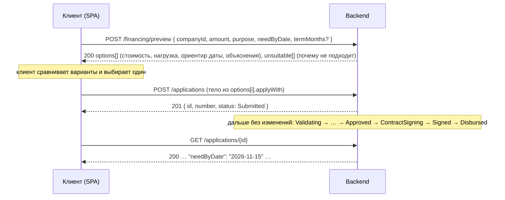

# Предварительный подбор финансирования: `POST /api/financing/preview`

Контракт API для нового интерфейса «Нужны деньги к дате». Клиент отвечает на три вопроса (на что, сколько, к какому дню),
backend показывает, какие продукты подходят, во что обойдётся каждый вариант и успеют ли деньги к нужной дате.
Выбранный вариант отправляется как обычная заявка: действующий конвейер (обработка → решение → предложение → договор →
подписание → выдача) не меняется, к заявке добавляется только поле `needByDate`.

Preview **не создаёт заявку и ничего не сохраняет**: его можно вызывать сколько угодно раз, меняя сумму и дату.
Все методы под `/api`, JSON, `Authorization: Bearer <JWT>`, ошибки в формате ProblemDetails (см. `docs/api.md`).

## Путь клиента



| Шаг интерфейса (юзерфлоу) | Запрос | Что показать |
|---|---|---|
| «Ответить на 3 вопроса: на что, сколько, к какому дню» | `POST /api/financing/preview` | форма: компания из `GET /api/companies`, сумма, цель, дата, необязательный срок |
| «Совет с учётом даты: какой кредит успеет и какая переплата» | ответ preview | карточки `options[]`: платёж, переплата, ориентир даты, `isRecommended` |
| «Сравнить варианты» | тот же ответ | `cost`, `affordability` («потяну ли платёж»), `funding` («успею ли к дате»), `explanations`, `limitations`, `requirements` («что нужно для оформления») |
| «Вариантов нет» | ответ с пустым `options` | `summary` и `unsuitable[].reasons` простыми словами: что изменить, чтобы вариант появился |
| «Подаёт сейчас» | `POST /api/applications` с `options[i].applyWith` | дальше карточка заявки как сейчас |

## Запрос

```json
{
  "companyId": "01a15975-ea5f-7a4f-863b-9035b3b8b2ca",
  "amount": 1500000,
  "purpose": "WorkingCapital",
  "needByDate": "2026-11-15",
  "termMonths": 12
}
```

| Поле | Тип | Обязательно | Правила |
|---|---|---|---|
| `companyId` | uuid | да | своя компания (клиент); сотрудник банка может считать для любой |
| `amount` | number | да | > 0, не больше 1 000 000 000; сравнивается с границами каждого продукта |
| `purpose` | enum | да | `WorkingCapital`, `Equipment`, `Expansion`, `Refinancing`, `Other` |
| `needByDate` | date `YYYY-MM-DD` | да | к какой дате нужны деньги: не раньше сегодняшнего дня (UTC) и не позже чем через 2 года |
| `termMonths` | int | нет | 1..120. Если указан, продукты с другим диапазоном сроков попадают в `unsuitable`. Если не указан, срок подбирается для каждого продукта (см. ниже) |

| Код | Когда | Тело |
|---|---|---|
| 200 | расчёт выполнен, в том числе когда подходящих вариантов нет (`options` пустой) | см. ниже |
| 400 | ошибка валидации: `errors.amount`, `errors.purpose`, `errors.needByDate` («не может быть раньше сегодняшнего дня»), `errors.termMonths`, `errors.companyId` («Компания не найдена.») | ProblemDetails с `errors` |
| 401 | нет токена | |
| 403 | клиент не представитель компании | `title`, `detail` |

## Ответ

ООО «Ромашка» (`client_good`), 1 500 000 ₽ на пополнение оборотных средств к 15.11.2026, срок 12 мес., расчёт 23.10.2026.
Подходят четыре продукта, показаны два; «Инвестиционный кредит» не подходит по цели.

```json
{
  "calculatedAt": "2026-10-24T10:44:41.0363416+00:00",
  "company": {
    "id": "01a16d82-bea0-7edd-9a95-4a3900d0cb9c",
    "name": "ООО «Ромашка»",
    "inn": "7701234567",
    "businessAgeMonths": 91
  },
  "request": {
    "amount": 1500000,
    "purpose": "WorkingCapital",
    "purposeTitle": "Пополнение оборотных средств",
    "needByDate": "2026-11-16",
    "daysUntilNeeded": 23,
    "termMonths": 12
  },
  "summary": "Подходят 4 варианта из 5. Рекомендуем «Кредитная линия»: платёж 137 877 ₽ в месяц, переплата 154 526 ₽ за 12 мес., деньги ориентировочно 26.10.2026, к нужной дате успеваем.",
  "disclaimer": "Предварительный расчёт по базовым ставкам продуктов и данным компании из кабинета. Точные условия банк назначает после проверки заявки: ставка зависит от оценки риска, сумма может быть снижена. Заявка не создана.",
  "options": [
    {
      "productCode": "credit-line",
      "productName": "Кредитная линия",
      "productType": "CreditLine",
      "isRecommended": true,
      "amount": 1500000,
      "termMonths": 12,
      "termSuggested": false,
      "termRange": {
        "min": 6,
        "max": 36
      },
      "cost": {
        "interestRate": 18.5,
        "maxInterestRate": 21.5,
        "monthlyPayment": 137877.18,
        "maxMonthlyPayment": 140030.86,
        "totalPayment": 1654526.12,
        "totalInterest": 154526.12,
        "maxTotalInterest": 180370.38
      },
      "affordability": {
        "monthlyProfit": 600000.0,
        "currentDebtPayments": 150000.0,
        "debtLoad": 0.48,
        "level": "Moderate",
        "profitBasis": "NetProfit",
        "explanation": "Платёж 137 877 ₽ вместе с текущими платежами 150 000 ₽ составит 48 % месячной прибыли 600 000 ₽: заметная, но посильная нагрузка (30–50 %)."
      },
      "funding": {
        "decisionPath": "Auto",
        "businessDays": 1,
        "expectedDate": "2026-10-26",
        "inTime": true,
        "explanation": "Решение принимается автоматически, сумма в пределах лимита 5 000 000 ₽: деньги ориентировочно 26.10.2026, до нужной даты 16.11.2026 остаётся 21 день."
      },
      "explanations": [
        {
          "code": "product_about",
          "text": "Возобновляемый лимит для регулярных закупок и расширения. Транши выбираются по мере необходимости."
        },
        {
          "code": "no_collateral",
          "text": "Без залога."
        },
        {
          "code": "auto_decision",
          "text": "Решение принимается автоматически: сумма в пределах лимита автоодобрения 5 000 000 ₽."
        },
        {
          "code": "data_prefilled",
          "text": "Выручка, налоги и реквизиты подгружаются из кабинета автоматически, вводить их не нужно."
        },
        {
          "code": "cheapest",
          "text": "Самая низкая переплата среди подходящих вариантов."
        }
      ],
      "limitations": [
        {
          "code": "rate_depends_on_risk",
          "text": "Ставка от 18,5 % до 21,5 % годовых: точную ставку банк назначает после оценки риска."
        }
      ],
      "requirements": [
        {
          "code": "credit_history_consent",
          "text": "Согласие на запрос кредитной истории: без него заявку нельзя подать."
        }
      ],
      "applyWith": {
        "companyId": "01a16d82-bea0-7edd-9a95-4a3900d0cb9c",
        "productCode": "credit-line",
        "amount": 1500000,
        "termMonths": 12,
        "purpose": "WorkingCapital",
        "needByDate": "2026-11-16"
      }
    },
    {
      "productCode": "working-capital",
      "productName": "Оборотный кредит",
      "productType": "WorkingCapital",
      "isRecommended": false,
      "amount": 1500000,
      "termMonths": 12,
      "termSuggested": false,
      "termRange": {
        "min": 3,
        "max": 24
      },
      "cost": {
        "interestRate": 19.5,
        "maxInterestRate": 22.5,
        "monthlyPayment": 138593.06,
        "maxMonthlyPayment": 140752.78,
        "totalPayment": 1663116.74,
        "totalInterest": 163116.74,
        "maxTotalInterest": 189033.3
      },
      "affordability": {
        "monthlyProfit": 600000.0,
        "currentDebtPayments": 150000.0,
        "debtLoad": 0.48,
        "level": "Moderate",
        "profitBasis": "NetProfit",
        "explanation": "…"
      },
      "funding": {
        "decisionPath": "Auto",
        "businessDays": 1,
        "expectedDate": "2026-10-26",
        "inTime": true,
        "explanation": "…"
      },
      "explanations": [
        "…"
      ],
      "limitations": [
        {
          "code": "rate_depends_on_risk",
          "text": "Ставка от 19,5 % до 22,5 % годовых: точную ставку банк назначает после оценки риска."
        }
      ],
      "requirements": [
        "…"
      ],
      "applyWith": {
        "companyId": "01a16d82-bea0-7edd-9a95-4a3900d0cb9c",
        "productCode": "working-capital",
        "amount": 1500000,
        "termMonths": 12,
        "purpose": "WorkingCapital",
        "needByDate": "2026-11-16"
      }
    }
  ],
  "unsuitable": [
    {
      "productCode": "investment",
      "productName": "Инвестиционный кредит",
      "reasons": [
        {
          "code": "purpose_not_allowed",
          "text": "Цель «Пополнение оборотных средств» недоступна. Доступные цели: «Покупка оборудования или транспорта», «Расширение бизнеса», «Рефинансирование кредитов»."
        }
      ]
    }
  ]
}
```

Примеры в этом документе сняты с запущенного стенда (seed, расчёт 23.10.2026) и сокращены: `"…"` обозначает
опущенные поля. Полные ответы для любого демо-клиента можно получить запросами из `docs/requests.http`.

### Поля ответа

| Поле | Описание |
|---|---|
| `calculatedAt` | момент расчёта (UTC); ответ не сохраняется, повторный запрос считается заново |
| `company` | компания из запроса; `businessAgeMonths` на дату расчёта |
| `request` | эхо запроса: `purposeTitle` для интерфейса, `daysUntilNeeded` дней от сегодня до `needByDate`, `termMonths` как в запросе (`null`, если не указан) |
| `summary` | одна фраза для заголовка: сколько вариантов, какой рекомендован и почему, либо почему вариантов нет |
| `disclaimer` | текст-оговорка под расчётом; выводится как есть |
| `options[]` | подходящие продукты, отсортированы: сначала те, что успевают к дате, затем по возрастанию переплаты; первый помечен `isRecommended` |
| `unsuitable[]` | продукты, которые не подходят, с причинами по кодам (таблица ниже); пустой, если подходят все |

| Поле `options[]` | Описание |
|---|---|
| `productCode`, `productName`, `productType` | продукт из `GET /api/products` |
| `amount` | сумма из запроса, ₽ |
| `termMonths`, `termSuggested`, `termRange` | срок расчёта; `termSuggested` = `true`, если срок не был указан и подобран системой (см. правила); `termRange` границы продукта, чтобы интерфейс дал поправить срок |
| `cost.interestRate` | базовая ставка продукта, % годовых: ставка при низком риске (грейд A) |
| `cost.maxInterestRate` | базовая ставка + 3 п.п.: верхняя граница при автоматическом одобрении (грейд C) |
| `cost.monthlyPayment`, `cost.totalPayment`, `cost.totalInterest` | аннуитетный платёж, сумма всех платежей и переплата при `interestRate`, ₽ |
| `cost.maxMonthlyPayment`, `cost.maxTotalInterest` | то же при `maxInterestRate`: интерфейс показывает «от … до …» |
| `affordability.monthlyProfit` | месячная прибыль компании, по которой считается нагрузка, ₽ |
| `affordability.currentDebtPayments` | текущие ежемесячные платежи по кредитам и лизингу из карточки компании, ₽ |
| `affordability.debtLoad` | (текущие платежи + новый платёж) / месячная прибыль, доля с двумя знаками, не больше 9.99; `null`, если прибыли нет |
| `affordability.level` | `Comfortable` (< 30 %), `Moderate` (30–50 %), `Elevated` (50–70 %: оценка риска снижается), `High` (≥ 70 % или нет прибыли). Те же банды, что у фактора `debt_load` правил скоринга `rules-0.3` (+10 / 0 / −10 / −25 баллов) |
| `affordability.profitBasis` | откуда прибыль: `NetProfit` (чистая прибыль за 12 мес.), `RevenueMinusExpenses` (выручка минус расходы), `RevenueEstimate` (прибыль и расходы неизвестны: принято 10 % выручки) |
| `affordability.explanation` | фраза для клиента |
| `funding.decisionPath` | `Auto`: сумма в лимите автоодобрения и залог не нужен; `ManualReview`: решение принимает менеджер |
| `funding.businessDays`, `funding.expectedDate` | ориентир: через сколько рабочих дней после подачи деньги обычно на счёте и какая это дата |
| `funding.inTime` | `expectedDate` не позже `needByDate` |
| `funding.explanation` | фраза для клиента: почему такой срок и успеваем ли |
| `explanations[]` | почему вариант подходит и что в нём важно: `product_about`, `no_collateral`, `auto_decision`, `term_suggested`, `data_prefilled`, `cheapest` (у варианта с минимальной переплатой) |
| `limitations[]` | что может изменить условия или срок: `rate_depends_on_risk`, `manual_review_amount`, `collateral_required`, `amount_may_be_reduced` (сумма выше 25 % годовой выручки), `expense_ratio_high` (расходы больше 90 % выручки), `elevated_debt_load`, `high_debt_load`, `deadline_missed` |
| `requirements[]` | что нужно для оформления: `credit_history_consent`, `financials_required` (расходы и прибыль за 12 мес. для сумм выше 3 000 000 ₽ и продуктов «Кредитная линия», «Инвестиционный», если их нет в карточке), `collateral_documents` |
| `applyWith` | готовое тело для `POST /api/applications`: продукт, сумма, срок, цель и `needByDate`; интерфейс отправляет его без изменений |

Все элементы `explanations`, `limitations`, `requirements` и `unsuitable[].reasons` имеют вид `{ "code", "text" }`:
текст показывается как есть, код нужен для иконок и тестов.

| Код причины `unsuitable[].reasons` | Когда |
|---|---|
| `purpose_not_allowed` | цель не входит в допустимые цели продукта; в тексте перечислены доступные |
| `amount_below_min`, `amount_above_max` | сумма вне границ продукта; в тексте граница |
| `term_out_of_range` | указанный `termMonths` вне границ продукта; в тексте диапазон |
| `business_too_young` | возраст бизнеса меньше минимального для продукта; в тексте оба значения |
| `product_inactive` | продукт отключён администратором |

### Вариантов нет

ИП Петрова (`client_new`, бизнесу 4 месяца), 500 000 ₽ на оборотные средства. `summary` собирает одинаковые причины
разных продуктов в одну фразу:

```json
{
  "calculatedAt": "2026-10-24T10:44:41.4332537+00:00",
  "company": {
    "id": "01a16d82-bec9-7cca-9349-944589235d86",
    "name": "ИП Петрова Елена Викторовна",
    "inn": "772812345678",
    "businessAgeMonths": 4
  },
  "request": {
    "amount": 500000,
    "purpose": "WorkingCapital",
    "purposeTitle": "Пополнение оборотных средств",
    "needByDate": "2026-12-02",
    "daysUntilNeeded": 39,
    "termMonths": null
  },
  "summary": "Подходящих продуктов нет. Возраст бизнеса 4 мес., для продукта требуется не менее 12 мес. Продукты: «Оборотный кредит», «Кредитная линия». Возраст бизнеса 4 мес., для продукта требуется не менее 6 мес. Продукты: «Экспресс-кредит», «Овердрафт». Цель «Пополнение оборотных средств» недоступна. Доступные цели: «Покупка оборудования или транспорта», «Расширение бизнеса», «Рефинансирование кредитов». Продукт: «Инвестиционный кредит». Минимальная сумма продукта 1 000 000 ₽. Продукт: «Инвестиционный кредит». Возраст бизнеса 4 мес., для продукта требуется не менее 24 мес. Продукт: «Инвестиционный кредит».",
  "disclaimer": "Предварительный расчёт по базовым ставкам продуктов и данным компании из кабинета. Точные условия банк назначает после проверки заявки: ставка зависит от оценки риска, сумма может быть снижена. Заявка не создана.",
  "options": [],
  "unsuitable": [
    {
      "productCode": "working-capital",
      "productName": "Оборотный кредит",
      "reasons": [
        {
          "code": "business_too_young",
          "text": "Возраст бизнеса 4 мес., для продукта требуется не менее 12 мес."
        }
      ]
    },
    {
      "productCode": "express",
      "productName": "Экспресс-кредит",
      "reasons": [
        {
          "code": "business_too_young",
          "text": "Возраст бизнеса 4 мес., для продукта требуется не менее 6 мес."
        }
      ]
    },
    {
      "productCode": "overdraft",
      "productName": "Овердрафт",
      "reasons": [
        {
          "code": "business_too_young",
          "text": "Возраст бизнеса 4 мес., для продукта требуется не менее 6 мес."
        }
      ]
    },
    {
      "productCode": "credit-line",
      "productName": "Кредитная линия",
      "reasons": [
        {
          "code": "business_too_young",
          "text": "Возраст бизнеса 4 мес., для продукта требуется не менее 12 мес."
        }
      ]
    },
    {
      "productCode": "investment",
      "productName": "Инвестиционный кредит",
      "reasons": [
        {
          "code": "purpose_not_allowed",
          "text": "Цель «Пополнение оборотных средств» недоступна. Доступные цели: «Покупка оборудования или транспорта», «Расширение бизнеса», «Рефинансирование кредитов»."
        },
        {
          "code": "amount_below_min",
          "text": "Минимальная сумма продукта 1 000 000 ₽."
        },
        {
          "code": "business_too_young",
          "text": "Возраст бизнеса 4 мес., для продукта требуется не менее 24 мес."
        }
      ]
    }
  ]
}
```

### Ручное рассмотрение, залог и дата, к которой не успеть

ООО «Вектор» (`client_manual`), 5 000 000 ₽ на оборудование к 02.11.2026 без срока. Подходят «Кредитная линия»
(сумма ровно в лимите автоодобрения, срок подобран 36 мес.) и «Инвестиционный кредит» (залог, менеджер, 10 рабочих дней:
ориентир 06.11.2026 позже нужной даты, поэтому вариант идёт вторым):

```json
{
  "options": [
    {
      "productCode": "credit-line",
      "isRecommended": true,
      "termMonths": 36,
      "termSuggested": true,
      "termRange": {
        "min": 6,
        "max": 36
      },
      "cost": {
        "interestRate": 18.5,
        "maxInterestRate": 21.5,
        "monthlyPayment": 182018.57,
        "maxMonthlyPayment": 189661.37,
        "totalPayment": 6552668.58,
        "totalInterest": 1552668.58,
        "maxTotalInterest": 1827809.25
      },
      "affordability": {
        "monthlyProfit": 1333333.33,
        "currentDebtPayments": 1200000.0,
        "debtLoad": 1.04,
        "level": "High",
        "profitBasis": "NetProfit",
        "explanation": "…"
      },
      "funding": {
        "decisionPath": "Auto",
        "businessDays": 1,
        "expectedDate": "2026-10-26",
        "inTime": true,
        "explanation": "Решение принимается автоматически, сумма в пределах лимита 5 000 000 ₽: деньги ориентировочно 26.10.2026, до нужной даты 03.11.2026 остаётся 8 дней."
      },
      "limitations": [
        {
          "code": "rate_depends_on_risk",
          "text": "…"
        },
        {
          "code": "high_debt_load",
          "text": "Платёж вместе с текущими обязательствами составит 104 % месячной прибыли: возможен отказ или снижение суммы."
        }
      ],
      "requirements": [
        {
          "code": "credit_history_consent",
          "text": "…"
        }
      ],
      "…": "…"
    },
    {
      "productCode": "investment",
      "isRecommended": false,
      "termMonths": 84,
      "termSuggested": true,
      "termRange": {
        "min": 12,
        "max": 84
      },
      "cost": {
        "interestRate": 17.5,
        "maxInterestRate": 20.5,
        "monthlyPayment": 103628.97,
        "maxMonthlyPayment": 112541.21,
        "totalPayment": 8704833.32,
        "totalInterest": 3704833.32,
        "maxTotalInterest": 4453461.34
      },
      "affordability": {
        "monthlyProfit": 1333333.33,
        "currentDebtPayments": 1200000.0,
        "debtLoad": 0.98,
        "level": "High",
        "profitBasis": "NetProfit",
        "explanation": "…"
      },
      "funding": {
        "decisionPath": "ManualReview",
        "businessDays": 10,
        "expectedDate": "2026-11-06",
        "inTime": false,
        "explanation": "Нужен залог, решение принимает менеджер: деньги ориентировочно 06.11.2026, это позже нужной даты 03.11.2026."
      },
      "limitations": [
        {
          "code": "rate_depends_on_risk",
          "text": "…"
        },
        {
          "code": "manual_review_amount",
          "text": "Сумма выше лимита автоодобрения 3 000 000 ₽: решение принимает кредитный менеджер."
        },
        {
          "code": "collateral_required",
          "text": "Нужен залог: его оформление и оценка занимают до 10 рабочих дней."
        },
        {
          "code": "high_debt_load",
          "text": "…"
        },
        {
          "code": "deadline_missed",
          "text": "Ориентир получения 06.11.2026 позже нужной даты 03.11.2026."
        }
      ],
      "requirements": [
        {
          "code": "credit_history_consent",
          "text": "…"
        },
        {
          "code": "collateral_documents",
          "text": "Документы на предмет залога."
        }
      ],
      "…": "…"
    }
  ],
  "unsuitable": [
    {
      "productCode": "working-capital",
      "productName": "Оборотный кредит",
      "reasons": [
        {
          "code": "purpose_not_allowed",
          "text": "…"
        }
      ]
    },
    {
      "productCode": "express",
      "productName": "Экспресс-кредит",
      "reasons": [
        {
          "code": "amount_above_max",
          "text": "Максимальная сумма продукта 3 000 000 ₽."
        }
      ]
    },
    {
      "productCode": "overdraft",
      "productName": "Овердрафт",
      "reasons": [
        {
          "code": "purpose_not_allowed",
          "text": "…"
        }
      ]
    }
  ]
}
```

## Как подбираются варианты

Проверяются все активные продукты из `GET /api/products`, те же правила, что при подаче заявки (`CreditApplication.Create`),
поэтому вариант из `options` всегда проходит валидацию `POST /api/applications` с тем же телом.

| Правило | Источник | Если не выполняется |
|---|---|---|
| цель входит в `allowedPurposes` | продукт | `purpose_not_allowed` |
| сумма в `minAmount..maxAmount` | продукт | `amount_below_min` / `amount_above_max` |
| срок в `minTermMonths..maxTermMonths` (только если `termMonths` указан) | продукт | `term_out_of_range` |
| возраст бизнеса ≥ `minBusinessAgeMonths` (полных месяцев с даты регистрации на дату расчёта) | компания | `business_too_young` |
| продукт активен | продукт | `product_inactive` |

**Срок, если не указан.** Для каждого продукта берётся самый короткий срок из его диапазона, при котором нагрузка
(`affordability.debtLoad`) меньше 30 % (комфортная); если такого нет, самый короткий с нагрузкой меньше 50 % (без штрафа
в скоринге); затем меньше 70 %; если и такого нет, максимальный срок продукта (нагрузка остаётся высокой, об этом говорит
`high_debt_load`). Короткий срок даёт минимальную переплату, порог нагрузки защищает от неподъёмного платежа и от штрафа в оценке риска. Клиент может выбрать любой срок из `termRange`
и пересчитать preview с `termMonths`.

**Сортировка и рекомендация.** Сначала варианты с `funding.inTime` = `true`, внутри группы по возрастанию `cost.totalInterest`,
при равенстве по порядку витрины. Первый вариант получает `isRecommended` = `true` и объяснение `cheapest`, если его переплата минимальна.

## Как считается стоимость

Все суммы считает сервер; интерфейс ничего не пересчитывает.

- **Платёж**: аннуитет по базовой ставке продукта, `LoanMath.MonthlyPayment` — та же функция, что считает
  `estimated_monthly_payment_rub` в запросе к сервису скоринга и платёж в предложении и договоре.
  `P = S × r / (1 − (1 + r)^−n)`, где `S` сумма, `r` = ставка / 100 / 12, `n` срок в месяцах; копейки по банковскому округлению.
- **Сумма всех платежей и переплата**: по графику `LoanMath.Schedule` (проценты на остаток, последний платёж закрывает остаток
  ровно до нуля), поэтому цифры совпадают с `totalPayment` и `totalInterest` будущего договора при той же ставке.
- **Диапазон ставки**: `interestRate` = базовая ставка продукта (грейд A, надбавка 0), `maxInterestRate` = базовая + 3 п.п.
  (грейд C, верхняя граница автоматического одобрения; шкала надбавок в `docs/decision-logic.md`).
  Грейды D и E автоматического предложения не получают, поэтому в диапазон не входят.
- **Нагрузка** (`affordability`): `(текущие платежи по кредитам в месяц + новый платёж) / месячная прибыль`, пороги 30, 50 и 70 %
  как у фактора `debt_load` правил скоринга `rules-0.3`. Месячная прибыль: чистая прибыль за 12 мес. / 12; если её нет,
  (выручка − расходы) / 12; если нет и расходов, 10 % выручки / 12 (те же правила, что в скоринге). Нет прибыли (0 или убыток):
  `debtLoad` = `null`, уровень `High`.
- **Расходы к выручке**: если расходы больше 90 % выручки, в `limitations` есть `expense_ratio_high` (фактор `expense_ratio`
  правил `rules-0.3`, −10 баллов).
- **Что может снизить сумму**: при грейде C политика ограничивает сумму 25 % годовой выручки (`DecisionPolicy:MaxAmountShareOfRevenue`);
  если запрошенная сумма больше, в `limitations` есть `amount_may_be_reduced` с рассчитанной границей.

### Согласовано с ML (`rules-0.3`)

Preview не вызывает сервис скоринга и не меняет запрос к нему (`docs/scoring-contract.md`, тест байт-в-байт `DemoSeedScoringTests` остаётся в силе;
`need_by_date` в запрос не передаётся). Цифры в кабинете и в скоринге считаются по одним правилам `rules-0.3`
(`docs/decision-logic.md`, `docs/calculation.md` в репозитории scoring):

1. Платёж: аннуитет `LoanMath.MonthlyPayment` по базовой ставке продукта, тот же, что в `estimated_monthly_payment_rub` запроса к скорингу
   (копия в `scripts/backend_reference.py` сервиса scoring).
2. Нагрузка: `(текущие платежи + новый платёж) × 12 / годовая прибыль`, банды 30 / 50 / 70 % (`FinancingPreview:ComfortableDebtLoad`,
   `ElevatedDebtLoad`, `HighDebtLoad`); уровни preview соответствуют вкладам фактора `debt_load` (+10 / 0 / −10 / −25).
3. Пропуски: прибыль = выручка − расходы, а без расходов 10 % выручки (`profitBasis` = `RevenueEstimate`); нагрузка показывается всегда,
   отдельного «грейда за нехватку данных» в правилах нет. Расходы больше 90 % выручки дают `expense_ratio_high`.

Изменение порогов делается в обоих репозиториях одновременно: новая версия правил и эталон в scoring, параметры `FinancingPreview` здесь.

## Ориентир получения денег

Считается от даты расчёта в рабочих днях (суббота и воскресенье пропускаются, праздники не учитываются; даты в UTC).

| Путь | Условие | Рабочих дней (`FinancingPreview:*`) | Что говорим клиенту |
|---|---|---|---|
| `Auto` | сумма ≤ `autoApprovalLimit` продукта и залог не нужен | `AutoDecisionBusinessDays` = 1 | решение автоматическое за несколько минут, деньги после подписания договора |
| `ManualReview` | сумма > `autoApprovalLimit` | `ManualReviewBusinessDays` = 3 | решение принимает менеджер |
| `ManualReview` | продукт требует залог | `CollateralBusinessDays` = 10 | оформление и оценка залога |

На демонстрационном стенде конвейер и смоделированный менеджер отвечают за секунды; ориентир описывает реалистичный срок,
а не время демо. `inTime` = `expectedDate ≤ needByDate`; если не успеваем, в `limitations` есть `deadline_missed`, а вариант
опускается ниже тех, что успевают.

## Поле `needByDate` в заявке

| Метод | Изменение |
|---|---|
| `POST /api/applications` | необязательное поле `needByDate` (`YYYY-MM-DD`): не раньше сегодняшнего дня и не позже чем через 2 года, иначе 400 с `errors.needByDate`. Без поля заявка создаётся как раньше |
| `GET /api/applications/{id}` | поле `needByDate` после `purposeDescription`: дата или `null` (старые заявки и заявки без даты) |
| `GET /api/applications` | то же поле в элементах списка |
| лента событий | в сообщении о приёме заявки добавляется «Деньги нужны к 15.11.2026», если дата указана |

Дата хранится и показывается; на конвейер, скоринг, решение, договор и выдачу она не влияет. Запрос к скорингу не меняется.

## Перечень изменений API и БД

| Где | Что | Совместимость |
|---|---|---|
| API | новый `POST /api/financing/preview` | только добавление |
| API | `POST /api/applications`: необязательное `needByDate` | старые запросы без поля работают |
| API | `GET /api/applications/{id}`, `GET /api/applications`: новое поле `needByDate` (`null` для старых заявок) | только добавление, остальные поля без изменений |
| БД | `credit_applications.need_by_date date NULL`, миграция `AddApplicationNeedByDate` | применяется к существующей базе без преобразования данных, старые строки получают `NULL` |
| Конфигурация | секция `FinancingPreview` в `appsettings.json` (см. ниже); значения по умолчанию подходят для стенда, в compose ничего менять не нужно | |
| Скоринг | без изменений | |

### Конфигурация

| Ключ (`appsettings.json` / env) | По умолчанию | Назначение |
|---|---|---|
| `FinancingPreview__AutoDecisionBusinessDays` | `1` | рабочих дней до денег при автоматическом решении |
| `FinancingPreview__ManualReviewBusinessDays` | `3` | то же при рассмотрении менеджером |
| `FinancingPreview__CollateralBusinessDays` | `10` | то же для продуктов с залогом |
| `FinancingPreview__ComfortableDebtLoad` | `0.30` | порог «комфортной» нагрузки (доля месячной прибыли); в скоринге +10 баллов |
| `FinancingPreview__ElevatedDebtLoad` | `0.50` | порог «повышенной» нагрузки; с него в скоринге начинается штраф |
| `FinancingPreview__HighDebtLoad` | `0.70` | порог «высокой» нагрузки; в скоринге максимальный штраф |
| `FinancingPreview__MaxNeedByDays` | `730` | насколько далеко вперёд можно указать `needByDate` |

## Что нужно фронтенду

Типы для `src/types/api.ts` (имена полей совпадают с JSON выше):

```ts
export interface FinancingPreviewRequest {
  companyId: string
  amount: number
  purpose: LoanPurpose
  needByDate: string          // YYYY-MM-DD
  termMonths?: number
}

export interface PreviewNote { code: string; text: string }

export interface FinancingOption {
  productCode: string
  productName: string
  productType: string
  isRecommended: boolean
  amount: number
  termMonths: number
  termSuggested: boolean
  termRange: { min: number; max: number }
  cost: { interestRate: number; maxInterestRate: number; monthlyPayment: number; maxMonthlyPayment: number; totalPayment: number; totalInterest: number; maxTotalInterest: number }
  affordability: { monthlyProfit: number; currentDebtPayments: number; debtLoad: number | null; level: 'Comfortable' | 'Moderate' | 'Elevated' | 'High'; profitBasis: 'NetProfit' | 'RevenueMinusExpenses' | 'RevenueEstimate'; explanation: string }
  funding: { decisionPath: 'Auto' | 'ManualReview'; businessDays: number; expectedDate: string; inTime: boolean; explanation: string }
  explanations: PreviewNote[]
  limitations: PreviewNote[]
  requirements: PreviewNote[]
  applyWith: CreateApplicationRequest   // CreateApplicationRequest получает needByDate?: string
}

export interface FinancingPreview {
  calculatedAt: string
  company: { id: string; name: string; inn: string; businessAgeMonths: number }
  request: { amount: number; purpose: LoanPurpose; purposeTitle: string; needByDate: string; daysUntilNeeded: number; termMonths: number | null }
  summary: string
  disclaimer: string
  options: FinancingOption[]
  unsuitable: Array<{ productCode: string; productName: string; reasons: PreviewNote[] }>
}
```

В `Application` и `ApplicationSummary` добавляется `needByDate: string | null`. Остальные типы не меняются.

## Передача на интеграцию

| Что | Где |
|---|---|
| Код | ветка `main`, коммит с сообщением `feat: financing preview and needByDate …`; хеш в сообщении о передаче |
| Реализация | `src/AlfaCredit.Core/Features/Financing/` (расчёт `FinancingAdvisor`, сервис, параметры), `src/AlfaCredit.Api/Controllers/FinancingController.cs`, `src/AlfaCredit.Api/Contracts/Financing/`, поле `NeedByDate` в `CreditApplication`, миграция `AddApplicationNeedByDate` |
| Проверки | юнит-тесты `tests/AlfaCredit.UnitTests/Financing/` (контрольные числа этого документа, подбор срока, пороги нагрузки, ориентиры дат, сортировка, права, валидация даты) и `CreditApplicationTests` (окно `needByDate`); интеграционные `FinancingEndpointsTests` (preview → `applyWith` → заявка с датой, старый формат без даты, 400/401/403, подбор без срока, «вариантов нет»); CI запускает оба набора на PostgreSQL в контейнере |
| Локальный стенд | миграция применена к базе с существующими заявками (старые строки получили `NULL`), preview по всем пяти демо-клиентам, заявка из `applyWith`, два перезапуска API: `needByDate` и статус сохраняются, путь обработка → решение → предложение → договор → подписание → выдача пройден на заявке с датой; существующие сценарии завершения, параллельных действий и демо-менеджера прогнаны повторно |
| Конфигурация | новая секция `FinancingPreview` в `appsettings.json` (таблица выше); значения по умолчанию, в `docker-compose.yml` и `.env` ничего менять не нужно; запрос к сервису скоринга и его контракт не изменились |
| Фронтенд | `src/types/api.ts`: типы из раздела выше, `needByDate` в `CreateApplicationRequest`, `Application`, `ApplicationSummary`; `httpCreditApi.ts`: метод `previewFinancing(body)` → `POST /api/financing/preview` |
| ML | правила `rules-0.3` согласованы (раздел «Согласовано с ML»); изменение порогов нагрузки = новая версия правил в scoring и параметры `FinancingPreview__*` здесь |
