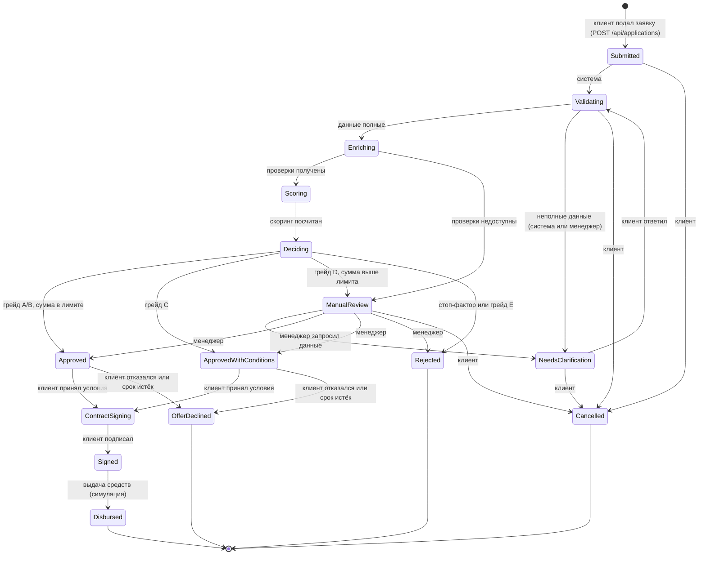

# Жизненный цикл кредитной заявки

Все переходы описаны в одном месте: `src/AlfaCredit.Core/Domain/Applications/ApplicationWorkflow.cs`.
Тексты статусов для интерфейса: `ApplicationStatusCatalog.cs`, доступны фронтенду через `GET /api/applications/statuses`.
Любая смена статуса проходит через `CreditApplication.ChangeStatus`, которая проверяет допустимость перехода,
пишет запись в историю и обновляет `updatedAt`. Прямой записи в поле статуса нет.

## Диаграмма

Статус `Draft` зарезервирован в перечислении на случай черновиков, но текущий API создаёт заявку сразу в `Submitted`:
мастер заявки хранит промежуточное состояние на стороне фронтенда.

## Таблица переходов

| Из | В | Кто | Когда |
|---|---|---|---|
| Submitted | Validating | система | конвейер взял заявку в работу |
| Submitted, Validating, NeedsClarification, ManualReview | Cancelled | клиент | `POST /api/applications/{id}/cancel` |
| Validating | Enriching | система | обязательные данные и документы на месте |
| Validating | NeedsClarification | система, менеджер | чего-то не хватает |
| NeedsClarification | Validating | клиент | ответ на запрос банка |
| Enriching | Scoring | система | все внешние проверки получены |
| Enriching | ManualReview | система | внешние проверки недоступны после повторных попыток |
| Scoring | Deciding | система | балл и грейд рассчитаны |
| Deciding | Approved / ApprovedWithConditions / Rejected / ManualReview | система | кредитная политика, см. `decision-logic.md` |
| ManualReview | Approved / ApprovedWithConditions / Rejected / NeedsClarification | менеджер | ручное решение с комментарием |
| Approved, ApprovedWithConditions | ContractSigning | клиент | принял предложение |
| Approved, ApprovedWithConditions | OfferDeclined | клиент, система | отказался или истёк срок предложения |
| ContractSigning | Signed | клиент | подписал договор кодом из кабинета |
| Signed | Disbursed | система | симуляция выдачи средств |

## Прогресс для клиента

Каждый статус несёт `progressStep` от 0 до 6 для прогресс-бара в кабинете:

| Шаг | Статусы |
|---|---|
| 1. Заявка отправлена | Submitted |
| 2. Проверка данных | Validating, NeedsClarification |
| 3. Проверки и оценка | Enriching, Scoring, Deciding, ManualReview |
| 4. Решение | Approved, ApprovedWithConditions, Rejected, OfferDeclined |
| 5. Договор | ContractSigning, Signed |
| 6. Выдача | Disbursed |

Терминальные статусы: Rejected, Cancelled, OfferDeclined, Disbursed.

## Действия в ответе API

`GET /api/applications/{id}` возвращает `availableActions`: действия, доступные текущему пользователю
в текущем статусе. Фронтенд показывает кнопки по этому списку, а не по своей копии правил.

| Действие | Переход | Эндпоинт |
|---|---|---|
| `cancel` | в Cancelled | `POST /api/applications/{id}/cancel` |
| `answerClarification` | NeedsClarification в Validating | этап 3 |
| `acceptOffer` | в ContractSigning | этап 4 |
| `declineOffer` | в OfferDeclined | этап 4 |
| `signContract` | в Signed | этап 4 |
| `requestClarification`, `approve`, `approveWithConditions`, `reject` | решения менеджера | этап 3 |
